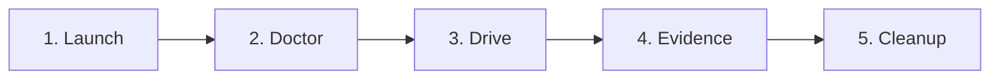

# Runtime Verification: `expo-open-api`

Execute this 5-phase verification protocol (`Launch`, `Doctor`, `Drive`, `Evidence`, `Cleanup`) before opening a PR or claiming a feature works end-to-end across **Expo SDK 58 / React Native 0.88 / Expo Router** (iOS, Android, and Web). Every phase ends on a checkable completion criterion.



---

## Phase 1: Launch

Determine whether `hono-open-api` is reachable locally or whether verification runs in hermetic offline mode:

```bash
mkdir -p .verification
if curl -fsS http://localhost:9999/health > .verification/backend-health.json 2>/dev/null; then
  echo "MODE=paired"
else
  echo "MODE=hermetic"
fi
```

- **Paired mode** (`http://localhost:9999/health` returns `200 OK`): Use `http://localhost:9999` (iOS Simulator / Web) or `http://10.0.2.2:9999` (Android Emulator) for live endpoint checks in Phase 3.
- **Hermetic mode** (backend offline): Rely on the MSW v2 + `vitest-native` boundary suite, CNG prebuild, multi-platform Metro static export (iOS, Android, Web), and Web static smoke verification.

**Done when**: `.verification/` exists and the active mode (`paired` or `hermetic`) is recorded.

---

## Phase 2: Doctor (Static, Contract & Design-Token Pre-Flight)

Run all static, contract-drift, WCAG contrast, and design-token checks:

```bash
# 1. Orval OpenAPI contract drift (use `pnpm sync:api` in paired mode to pull live /doc)
pnpm generate:api && git diff --exit-code src/shared/api/generated

# 2. Shared token, WCAG AA contrast (>= 4.5:1 text, >= 3.0:1 outline/UI), --scrim, and repo-wide color hygiene verifier
pnpm verify:tokens

# 3. Strict TypeScript typecheck
pnpm typecheck

# 4. Biome lint, formatting, FSD boundaries, and RN raw-text rules
pnpm lint
```

**Done when**: All four commands exit `0` with zero generated-code drift and zero contrast or color-hygiene violations.

---

## Phase 3: Drive (Tests, CNG Prebuild, Multi-Platform Export & 5 Feature Flows)

### 3.1 Automated Boundary Suite & Native/Bundle Integrity

```bash
# Full Vitest 4 + vitest-native + MSW v2 boundary suite (including architecture, token, UI primitive, screen, and docs hygiene suites)
pnpm test

# Continuous Native Generation validation (iOS + Android native project synthesis)
CI=1 pnpm prebuild

# Static production Metro bundles for iOS, Android, and Web (isolated TMPDIR avoids cache lock contention)
CI=1 TMPDIR="$(mktemp -d)" pnpm export -- --clear
```

### 3.2 Cross-Platform UI, Theme, Form & Safety Runtime Checklist

Verify these cross-cutting invariants across iOS, Android, and Web (`ADR-0014`) via the automated suites and interactive/live inspection:

1. **Zero Overlaps & Single-Header Tab Chrome**:
   - The themed `<Tabs>` header is the sole top header across `Home`, `Tasks`, `Files`, and `Showcase`; authenticated tab screens use horizontal-only `SafeAreaView` (`edges={["left", "right"]}`) with no redundant top/bottom safe-area gaps or duplicate page titles.
   - `TabsList` renders single-line horizontally scrollable tabs (`numberOfLines={1}`) without mid-word wrapping on 320–375px screens.
   - All narrow-screen rows (`ThemeSwitcher`, `ShowcaseScreen` swatches / `Switch`+`Checkbox` / `DropdownMenu` / `Popover`+`Tooltip`, `TasksScreen` status strip & filter pills, `FilesScreen` picker/upload/file rows, `LoginScreen`/`RegisterScreen`/`HomeScreen` footers) wrap or truncate cleanly without clipping.
2. **Tri-Layer Theme Sync & Bundled Typography**:
   - Switching `warm-tactile`, `editorial-slate`, and `neo-brutalist` across `light`, `dark`, and `system` updates NativeWind `vars()`, React Navigation `<ThemeProvider>` (headers, tab bar, `<Stack>`, `+not-found`), and Web `document.documentElement` CSS custom properties / `.dark` class / background color simultaneously so Radix portals inherit the active preset and OS dark mode.
   - `Quicksand` (Regular/Medium/SemiBold/Bold) and `JetBrains Mono` (Regular/Bold) hydrate during `useAppBootstrap` with graceful system-font fallback, and `Text` preserves `variant="muted"` / `variant="caption"` / `variant="label"` hierarchy inside `Card`, `Popover`, and `Alert`.
3. **Zero-Jump Forms & Auth Screens**:
   - Single-line `Input` and multiline `Textarea` hold steady focus styling (`border-outline`, preset radius & `elevation.borderWidth`, Web `outline-none`, Android `includeFontPadding: false`) with zero `useState` focus churn or vertical caret jumps.
   - `FormScrollView` applies `behavior="padding"` on iOS only (with dynamic `HeaderHeightContext` offset) and `undefined` on Android/Web; `FormMessage` reserves `min-h-5` so `onBlur` validation never shifts subsequent fields mid-tap.
   - `LoginScreen` and `RegisterScreen` run on top-anchored `useAppForm` + `FormScrollView` with keyboard `Next`/`Done` focus chaining, accessible show/hide password toggles, and `<Alert>` banners.
4. **Interactive Primitives, Overlays & Top-Anchored Toasts**:
   - `TactilePressable` compresses its offset shadow smoothly toward zero on press without outward clipping; `Slider` supports scroll-locked pan drag, accurate tap, Web pointer drag & keyboard navigation (`Arrow*`, `PageUp/Down`, `Home`, `End`, non-`NaN` `Space`/`Enter`), clamped thumb bounds, and step haptics.
   - All 6 overlay backdrops (`Dialog`, `AlertDialog`, `Sheet`, `Select`, `Popover`, `DropdownMenu`) use the mode-invariant `--scrim` token; Web `Dialog`/`AlertDialog`/`Sheet` use viewport-fixed positioning without width collapse; `Sheet` animates with bottom safe-area padding and swipe-down handle dismissal; `Select` displays `ItemText` labels with a scrollable viewport; `Tooltip` omits blocking overlays on Web; triggers/toggles guard against Web click double-fire.
   - `ToastViewport` mounts in its dedicated top safe-area portal (`TOAST_PORTAL_HOST`, `top: insets.top + 12`, `pointerEvents="box-none"`) above modals without overlapping tab bars or keyboards.
5. **Destructive Safety & Visible Error Feedback**:
   - `TasksScreen` and `FilesScreen` require `<AlertDialog>` confirmation before deleting items and render visible `<Alert>` / `<Toast>` errors on mutation, refresh, and `403 ForbiddenError` failures.

### 3.3 Core Feature Flow Verification

Consult the targeted guides in [`features/`](./features/README.md) whenever modifying a domain slice or running live/paired checks:

1. **`showcase-and-theming`** ([`features/showcase-and-theming.md`](./features/showcase-and-theming.md)) — `/(app)/showcase` & `/(app)`: tri-layer runtime switching across `warm-tactile`, `editorial-slate`, and `neo-brutalist` (`light`/`dark`/`system`), WCAG contrast tokens & `--scrim` backdrops, bundled fonts, shadow-compressing `TactilePressable`, rebuilt `Slider`, cross-platform `<PortalHost />` overlays, top-anchored `ToastProvider`, and `useAppForm` `FormControl` validation/reset.
2. **`auth-and-rbac`** ([`features/auth-and-rbac.md`](./features/auth-and-rbac.md)) — `/(auth)/login`, `/(auth)/register`, `/(app)`: Better Auth sign-in/up/out, `expo-secure-store` Bearer hydration, themed `AuthLayoutGuard`/`AppLayoutGuard` loaders & single-header `<Tabs>` chrome (`>= 44×44pt` locked `Sign out`), zero-jump auth forms, open-redirect blocking, `<Can />` RBAC, and 401 vs 403 discipline.
3. **`live-tasks`** ([`features/live-tasks.md`](./features/live-tasks.md)) — `/(app)/tasks`: streaming SSE `/api/v1/tasks/live` via `useLiveQuery`, compact wrapping status strip (`LiveQueryBadge`), skeleton loading & pull-to-refresh, `["tasks", "mutation"]` optimistic updates & anti-clobber buffering, `AlertDialog` delete confirmations, visible mutation/`403` errors, `AppState`/`NetInfo` reconnect, and MMKV persistence.
4. **`files-upload-and-download`** ([`features/files-upload-and-download.md`](./features/files-upload-and-download.md)) — `/(app)/files`: `useMobileFilePicker`, direct multipart (<= 10 MB) and 3-step presigned (<= 100 MB) uploads, 2-slot `useUploadQueue` abort/retry, shared `<Progress>` bars, visible `<Alert>` refresh/action errors, `AlertDialog` delete confirmations, 409 `FILE_PENDING` backoff, and `expo-sharing`.
5. **`observability-and-headers`** ([`features/observability-and-headers.md`](./features/observability-and-headers.md)) — all routes: outbound `X-Request-Id` and W3C `traceparent` headers, 5xx/decode `captureDefect` vs 4xx PII-redacted `recordBreadcrumb`, and `SpyObservabilityAdapter.assertNoDefects()`.

**Done when**: `pnpm test`, `CI=1 pnpm prebuild`, `CI=1 TMPDIR="$(mktemp -d)" pnpm export -- --clear`, and every modified feature flow pass with zero defects.

---

## Phase 4: Evidence

Capture structured verification artifacts in `.verification/` (gitignored):

1. Save command exit summaries, test counts, CNG prebuild confirmation, and Metro export bundle outputs (iOS, Android, Web) to `.verification/summary.md`.
2. In paired mode, record backend health status and live route smoke checks; in hermetic mode, verify Web bundle output in `dist/` and record the exact boundary test pass counts.
3. Confirm zero unexpected defects (`SpyObservabilityAdapter.assertNoDefects()`) and zero console/hydration errors.

**Done when**: `.verification/summary.md` records concrete command outputs for Phases 1–3.

---

## Phase 5: Cleanup

Remove all ephemeral build, native prebuild, and verification artifacts before committing so `git status` is spotless:

```bash
rm -rf ios android dist .expo .verification
git status --short
```

**Done when**: No untracked temporary artifacts (`ios/`, `android/`, `dist/`, `.expo/`, `.verification/`) remain and `git status` shows only intended changes.
