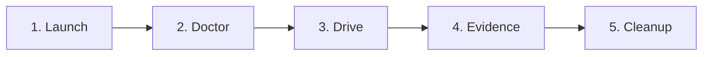

# Runtime Verification: `expo-open-api`

Execute this 5-phase verification protocol (`Launch`, `Doctor`, `Drive`, `Evidence`, `Cleanup`) before opening a PR or claiming a feature works end-to-end. Every phase ends on a checkable completion criterion.



---

## Phase 1: Launch

Determine whether `hono-open-api` is reachable locally or whether verification runs in hermetic offline mode:

```bash
mkdir -p .verification
if curl -fsS http://localhost:9999/health > .verification/backend-health.json 2>/dev/null; then
  echo "MODE=paired"
else
  echo "MODE=hermetic"
fi
```

- **Paired mode** (`http://localhost:9999/health` returns `200 OK`): Use `http://localhost:9999` (iOS Simulator / web) or `http://10.0.2.2:9999` (Android Emulator) for live endpoint checks in Phase 3.
- **Hermetic mode** (backend offline): Rely on the MSW v2 + `vitest-native` boundary suite, CNG prebuild, and multi-platform Metro export.

**Done when**: `.verification/` exists and the active mode (`paired` or `hermetic`) is recorded.

---

## Phase 2: Doctor (Static & Contract Pre-Flight)

Run all static, contract-drift, and design-token checks:

```bash
# 1. Orval OpenAPI contract drift (use `pnpm sync:api` in paired mode to pull live /doc)
pnpm generate:api && git diff --exit-code src/shared/api/generated

# 2. Single-source design token parity (DESIGN.md <-> global.css <-> tailwind.config.ts <-> tokens.ts)
pnpm verify:tokens

# 3. Strict TypeScript typecheck
pnpm typecheck

# 4. Biome lint, formatting, FSD boundaries, and RN raw-text rules
pnpm lint
```

**Done when**: All four commands exit `0` with zero generated-code drift.

---

## Phase 3: Drive (Tests, CNG Prebuild, Multi-Platform Export & 5 Feature Flows)

### 3.1 Automated Boundary Suite & Native/Bundle Integrity

```bash
# Full Vitest 4 + vitest-native + MSW v2 boundary suite (including architecture, token, and docs hygiene)
pnpm test

# Continuous Native Generation validation (iOS + Android native project synthesis)
CI=1 pnpm prebuild

# Static production Metro bundles for iOS, Android, and web (isolated TMPDIR avoids cache lock contention)
CI=1 TMPDIR="$(mktemp -d)" pnpm export -- --clear
```

### 3.2 Core Feature Flow Verification

Consult the targeted guides in [`features/`](./features/README.md) whenever modifying a domain slice or running live/paired checks:

1. **`showcase-and-theming`** ([`features/showcase-and-theming.md`](./features/showcase-and-theming.md)) — `/(app)/showcase`: runtime switching across `warm-tactile`, `editorial-slate`, and `neo-brutalist` (light/dark), `TactilePressable` elevation, `<PortalHost />` overlays, `ToastProvider`, and `useAppForm` validation.
2. **`auth-and-rbac`** ([`features/auth-and-rbac.md`](./features/auth-and-rbac.md)) — `/(auth)/login`, `/(auth)/register`, `/(app)`: Better Auth sign-in/up/out, `expo-secure-store` Bearer hydration, `AuthLayoutGuard`/`AppLayoutGuard` redirects, open-redirect blocking, `<Can />` RBAC, and 401 vs 403 discipline.
3. **`live-tasks`** ([`features/live-tasks.md`](./features/live-tasks.md)) — `/(app)/tasks`: streaming SSE `/api/v1/tasks/live` via `useLiveQuery`, `["tasks", "mutation"]` optimistic updates & microtask anti-clobber buffering, `AppState`/`NetInfo` reconnect, and MMKV persistence.
4. **`files-upload-and-download`** ([`features/files-upload-and-download.md`](./features/files-upload-and-download.md)) — `/(app)/files`: `useMobileFilePicker`, direct multipart (<= 10 MB) and 3-step presigned (<= 100 MB) uploads, 2-slot `useUploadQueue` abort/retry, 409 `FILE_PENDING` backoff, and `expo-sharing`.
5. **`observability-and-headers`** ([`features/observability-and-headers.md`](./features/observability-and-headers.md)) — all routes: outbound `X-Request-Id` and W3C `traceparent` headers, 5xx/decode `captureDefect` vs 4xx PII-redacted `recordBreadcrumb`, and `SpyObservabilityAdapter.assertNoDefects()`.

**Done when**: `pnpm test`, `CI=1 pnpm prebuild`, `CI=1 TMPDIR="$(mktemp -d)" pnpm export -- --clear`, and every modified feature flow pass with zero defects.

---

## Phase 4: Evidence

Capture structured verification artifacts in `.verification/` (gitignored):

1. Save command exit summaries, test counts, CNG prebuild confirmation, and Metro export bundle outputs to `.verification/summary.md`.
2. In paired mode, record backend health status and live route smoke checks.
3. Confirm zero unexpected defects (`SpyObservabilityAdapter.assertNoDefects()`) and zero console/hydration errors.

**Done when**: `.verification/summary.md` records concrete command outputs for Phases 1–3.

---

## Phase 5: Cleanup

Remove all ephemeral build, native prebuild, and verification artifacts before committing so `git status` is spotless:

```bash
rm -rf ios android dist .expo .verification
git status --short
```

**Done when**: No untracked temporary artifacts (`ios/`, `android/`, `dist/`, `.expo/`, `.verification/`) remain and `git status` shows only intended changes.
