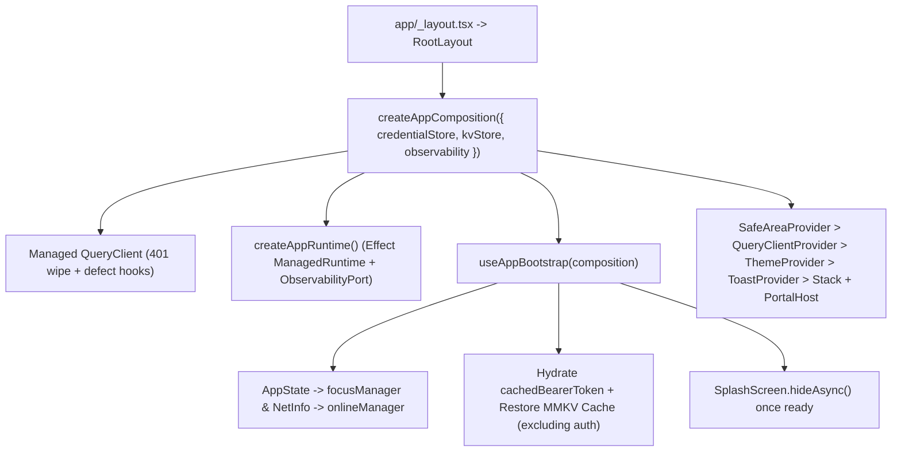
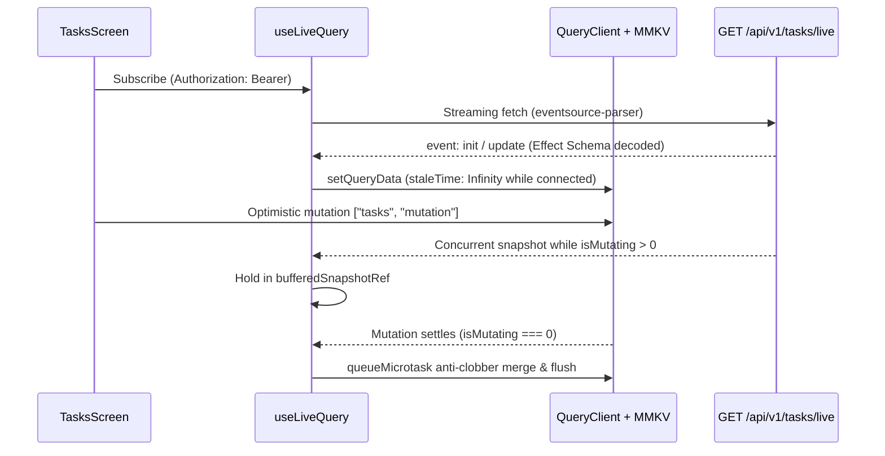

# Expo OpenAPI Starter — Architecture Guide

This document specifies the runtime composition, Mobile Feature-Sliced Design (FSD) boundaries, schema-validated API contracts, authentication, realtime SSE synchronization, observability, design system, file transfers, and CI/CD architecture of `expo-open-api`. It aligns with every Architecture Decision Record (`ADR-0001` through `ADR-0013`).

---

## 1. System Overview & ADR Index

`expo-open-api` is a React Native (Expo SDK 52, New Architecture) starter kit paired with [`hono-open-api`](https://github.com/Guiguerreiro39/hono-open-api). It delivers end-to-end OpenAPI type safety, hardware-backed mobile authentication, offline-capable TanStack Query caching, realtime Server-Sent Events, and mock-free contract testing across iOS, Android, and web.

### Architecture Decision Records (ADRs)

| ADR | Title | Core Decision & Impact |
| :-- | :---- | :--------------------- |
| **[`ADR-0001`](./adr/0001-mobile-fsd-architecture-and-composition-root.md)** | Feature-Sliced Design with Route Façades and Side-Effect-Free Composition Root | Enforces 4 FSD layers (`app/` Route Façades -> `src/app/` -> `src/features/` -> `src/shared/`) and isolated `createAppComposition` / `createAppRuntime` / `useAppBootstrap`. |
| **[`ADR-0002`](./adr/0002-orval-effect-contracts-and-error-taxonomy.md)** | Dual-Target Orval Codegen, Typed Effect Contracts, and Mobile Error Taxonomy | Dual-target Orval v8 codegen (`endpoints.ts` + `schemas.ts`), `defineContract`, and 11 HTTP status `Data.TaggedError` classes. |
| **[`ADR-0003`](./adr/0003-better-auth-mobile-session-and-rbac.md)** | Better Auth Client Integration, SecureStore Bearer Tokens, and Mobile RBAC | `@better-auth/expo` client, `expo-secure-store` Credential Tier, synchronous `cachedBearerToken`, pathless `(auth)`/`(app)` guards, and `<Can />` RBAC. |
| **[`ADR-0004`](./adr/0004-realtime-sse-live-queries-and-mutation-buffering.md)** | Realtime SSE Live Queries, Native Reconnection, and Mutation Buffering | `useLiveQuery` over `expo/fetch` + `eventsource-parser`, `AppState`/`NetInfo` lifecycle, `["tasks", "mutation"]` microtask buffering, and MMKV persistence. |
| **[`ADR-0005`](./adr/0005-mobile-observability-and-distributed-tracing.md)** | Mobile Observability Architecture, Sentry & Datadog Adapters, and Distributed Trace Correlation | Pluggable `ObservabilityPort` (Sentry, Datadog, Console, Noop, Composite, Spy), Defect vs Breadcrumb PII rules, W3C `traceparent` and `X-Request-Id`. |
| **[`ADR-0006`](./adr/0006-themeable-design-system-and-tactile-elevation.md)** | Single-Source Themeable Design System, NativeWind Tokens, and Mobile Tactile Elevation | `DESIGN.md` OKLCH-to-HSL space-separated token bridge, 3 runtime NativeWind `vars()` presets, and `TactilePressable` spring + haptic feedback. |
| **[`ADR-0007`](./adr/0007-react-native-reusables-catalog-and-form-primitives.md)** | React Native Reusables Component Catalog, Mobile Form Primitives, and Showcase Architecture | Owned `@rn-primitives` catalog in `src/shared/ui/`, single `<PortalHost />`, `ToastProvider`, `useAppForm` (`Schema.standardSchemaV1`), `FormScrollView`, and Showcase screen. |
| **[`ADR-0008`](./adr/0008-mobile-file-transfer-pipeline-and-native-sharing.md)** | Mobile File Transfer Pipeline, Upload Progress, and Native Sharing Architecture | `FileTransferPort` + `expo-file-system`, direct multipart (<= 10 MB) & 3-step presigned (<= 100 MB) uploads, 2-slot `useUploadQueue`, and `expo-sharing`. |
| **[`ADR-0009`](./adr/0009-mobile-testing-strategy-and-runtime-verification.md)** | Mobile Testing Strategy, Test Harness Architecture, and Runtime Verification Skill | Vitest 4 + `vitest-native` + MSW v2 mock-free harness (`SpyObservabilityAdapter.assertNoDefects()`) and `.agents/skills/verify-expo-open-api/SKILL.md`. |
| **[`ADR-0010`](./adr/0010-ci-cd-pipelines-expo-prebuild-and-release-automation.md)** | CI/CD Pipelines, Continuous Native Generation Validation, and Release Automation | Linux CI validating Orval drift, typecheck, Biome, Vitest, `expo prebuild --clean --no-install`, and `expo export --platform all` + Lefthook/Commitlint/Release-Please. |
| **[`ADR-0011`](./adr/0011-starter-documentation-suite-and-template-onboarding.md)** | Starter Documentation Suite, Developer Playbooks, and Template Onboarding | Canonical 7-file documentation suite with mobile network addressing, rebranding/restyle/pruning playbooks, and strict `AGENTS.md` guardrails. |
| **[`ADR-0012`](./adr/0012-prototyping-strategy-and-progressive-tracer-bullet-implementation.md)** | Prototyping Strategy and Progressive Tracer-Bullet Implementation | Production-grade vertical tracer bullets with just-in-time disposable spikes only for unanticipated native runtime friction. |
| **[`ADR-0013`](./adr/0013-master-specification-and-implementation-backlog-slicing.md)** | Master Specification Compilation and Implementation Backlog Slicing | Vertical dependency-ordered implementation backlog translating ADRs `0001`–`0012` into verifiable tracer-bullet tickets. |

---

## 2. Mobile FSD Layer Hierarchy & Unidirectional DAG (`ADR-0001`)

Source files are partitioned into four horizontal layers governed by a strict unidirectional Directed Acyclic Graph (DAG):

```text
app/              # Layer 4 (Entry): Thin Expo Router Route Façades (1-line re-exports)
src/
├── app/          # Layer 3 (Shell): Composition Root, Effect ManagedRuntime, App Bootstrap
├── features/     # Layer 2 (Verticals): Isolated Feature Slices (auth, home, tasks, files, showcase)
└── shared/       # Layer 1 (Foundation): UI Reusables, API contracts, storage ports, observability, config
```

### Dependency & Structural Rules

- **Unidirectional imports**: `app/` -> `src/app/` -> `src/features/<slice>/` -> `src/shared/`.
  - `src/shared/**` never imports from `src/features/**` or `src/app/**`.
  - `src/features/<slice-a>/**` never imports from `src/app/**` or `src/features/<slice-b>/**`.
- **Cross-slice coordination**: Navigation targets live in `src/shared/config/routes.ts`, query keys in `src/shared/api/query-keys.ts`, and session read access in `src/shared/lib/auth-session-bridge.ts`.
- **Slice segments & zero barrels**: Feature slices organize code into `api/`, `model/`, `ui/`, and `__tests__/` using direct file imports. Barrel `index.ts` files inside `src/features/**` are banned.
- **Automated enforcement**: Both [`biome.json`](../biome.json) (`style/noRestrictedImports`, `style/useFilenamingConvention`, `style/noProcessEnv`) and `src/app/__tests__/architecture.test.ts` fail CI on violations.

---

## 3. Side-Effect-Free Composition Root & App Bootstrap (`ADR-0001`)

The application eliminates module-level singletons so every mobile mount (`RootLayout`) and every Vitest render (`renderWithProviders`) runs against an isolated instance graph.



- **`createAppRuntime` (`src/app/runtime.ts`)**: Constructs an Effect `ManagedRuntime` providing `ObservabilityPort` plus optional layers, exposed to React via `AppRuntimeContext` / `useAppRuntime()`.
- **`createAppComposition` (`src/app/composition.ts`)**: Provisions `QueryClient` (with `QueryCache.onError` and `MutationCache.onError` routing defects and clearing credentials on HTTP 401), Effect `runtime`, `observability`, `credentialStore`, `kvStore`, and an explicit `dispose()` teardown.
- **`useAppBootstrap` (`src/app/bootstrap.ts`)**: Connects `AppState` to TanStack Query `focusManager`, connects `NetInfo` to `onlineManager`, registers `auth-session-bridge`, hydrates the persisted Bearer token into RAM, restores persisted offline queries from MMKV (excluding `["auth", "session"]`), prefetches the session, and dismisses `expo-splash-screen` only after initialization completes.

---

## 4. Orval v8 Dual-Target Codegen & Effect Contracts (`ADR-0002`)

API contracts are generated directly from `openapi.json` (mirrored from `hono-open-api`) via `orval.config.ts`:

1. **`src/shared/api/generated/endpoints.ts` + `models/`**: React Query hooks, query keys, URL builders, and TypeScript models routed through `customFetch` (`src/shared/api/client.ts` -> `src/shared/api/fetch.ts`).
2. **`src/shared/api/generated/schemas.ts`**: Runtime Effect `Schema` definitions per operation and HTTP status (`@orval/effect`).

### `defineContract`, `useEffectQuery`, `useEffectMutation`, and `matchEffect`

Feature slices bind endpoints with `defineContract({ operation, path, dataSchema })` in `src/shared/api/contracts.ts`. Responses are decoded at runtime against the generated Effect `Schema` (raising `SchemaDecodeError` on contract drift), and HTTP errors map deterministically into **11 HTTP status `Data.TaggedError` classes** plus `SchemaDecodeError` and `UnknownError`:

| Status | Tagged Error Class | Handling Discipline |
| :----- | :----------------- | :------------------ |
| `400` | `BadRequestError` | Breadcrumb; render contextual error message |
| `401` | `UnauthorizedError` | Wipe `cachedBearerToken`, SecureStore, and query cache; redirect to `/(auth)/login` |
| `403` | `ForbiddenError` | Breadcrumb; preserve session and render in-place access denial |
| `404` | `NotFoundError` | Breadcrumb; render resource-not-found UI |
| `408` | `RequestTimeoutError` | Breadcrumb; offer retry action |
| `409` | `ConflictError` | Breadcrumb; e.g., `FILE_PENDING` triggers exponential backoff retry |
| `413` | `PayloadTooLargeError` | Breadcrumb; prompt presigned strategy or smaller file |
| `422` | `ValidationError` | Breadcrumb; map `issues[]` into `useAppForm` via `applyServerValidationErrors` |
| `429` | `RateLimitError` | Breadcrumb; pause retries and surface backoff guidance |
| `500` | `InternalServerError` | **Defect** (`captureDefect`); render fallback alert |
| `503` | `ServiceUnavailableError` | **Defect** (`captureDefect`); render service-unavailable fallback |
| Drift / Network | `SchemaDecodeError` / `UnknownError` | **Defect** (`captureDefect`) |

UI components exhaustively branch on query state via `matchEffect(result, { onPending, onFailure, onSuccess })`.

---

## 5. Authentication, SecureStore Bearer Cache, Layout Guards & RBAC (`ADR-0003`)

- **Better Auth Mobile Client (`src/features/auth/api/client.ts`)**: Uses `better-auth/react` with `expoClient` (`@better-auth/expo/client`, `scheme: "expoopenapi"`, `storagePrefix: "expo_open_api"`) and `adminClient`.
- **Two-Tier Mobile Storage**:
  - **Credential Tier (`src/shared/storage/credential-store.ts`)**: `CredentialStorePort` backed by `expo-secure-store` (`keychainAccessible: AFTER_FIRST_UNLOCK`) stores authentication tokens exclusively.
  - **In-Memory Token Cache (`src/shared/lib/auth-session-bridge.ts`)**: `hydrateBearerToken` loads the stored token into `cachedBearerToken` once at startup so `customFetch` and SSE streams inject `Authorization: Bearer <token>` synchronously without per-request Keychain IPC.
- **Pathless Layout Guards**:
  - `app/(auth)/_layout.tsx` -> `AuthLayoutGuard`: redirects authenticated users to `sanitizeRedirect(params.redirect) ?? "/(app)"` (blocking open redirects like `//`, `://`, `\`).
  - `app/(app)/_layout.tsx` -> `AppLayoutGuard`: waits while bootstrapping, redirects unauthenticated users to `/(auth)/login`, subscribes to `onAuthUnauthorized` for immediate 401 redirects, and renders the themed bottom `<Tabs>` shell (`index`, `tasks`, `files`, `showcase`).
- **RBAC & `<Can />` (`src/shared/lib/rbac.ts`, `src/shared/ui/can.tsx`)**: Mirrors `hono-open-api` roles (`admin`, `member`, `viewer`) and resource scopes (`own` vs `all`) across `user`, `session`, `task`, and `file`. `<Can />` and `useCan()` read session state exclusively through `auth-session-bridge.ts` and fail closed when unauthenticated.

---

## 6. Realtime SSE Live Queries, Mutation Buffering & MMKV Cache (`ADR-0004`)

`useLiveQuery` (`src/shared/lib/hooks/use-live-query.ts`) synchronizes TanStack Query caches with `GET /api/v1/tasks/live` over streaming `expo/fetch` (`ReadableStream`) parsed by `eventsource-parser`.



- **Mobile Lifecycle Resilience**:
  - `AppState` `"background"` / `"inactive"` aborts the active `AbortController` to preserve battery; returning to `"active"` reconnects immediately with reset backoff.
  - `NetInfo` offline -> online recovery cancels backoff timers and reconnects immediately.
  - Reconnect delays apply exponential backoff (`1s` base or server `retry:` frame, `30s` cap) with jitter, halting immediately on non-retryable `4xx` responses (except `429`).
- **Mutation Buffering & Anti-Clobber Merge**: While `queryClient.isMutating({ mutationKey: ["tasks", "mutation"] }) > 0`, incoming SSE snapshots buffer in `bufferedSnapshotRef`. When active mutations drop to `0`, a `queueMicrotask` runs after optimistic `onSuccess` ID swaps and preserves newly created server items not yet present in the buffered snapshot.
- **MMKV Offline Query Persistence (`src/shared/storage/kv-store.ts`, `src/shared/storage/query-persister.ts`)**: `KeyValueStorePort` wraps `react-native-mmkv` via `@tanstack/query-sync-storage-persister`. `shouldDehydrateAppQuery` explicitly excludes `["auth", "session"]` so session PII never lands in unencrypted cache storage.

---

## 7. Mobile Observability & Distributed Trace Correlation (`ADR-0005`)

All telemetry flows through `ObservabilityPort` (`src/shared/observability/port.ts`):

- **Adapters (`src/shared/observability/`)**: `SentryObservabilityAdapter`, `DatadogObservabilityAdapter`, `ConsoleObservabilityAdapter`, `NoopObservabilityAdapter`, `CompositeObservabilityAdapter` (per-adapter `try/catch` fault isolation), and `SpyObservabilityAdapter` (for tests).
- **Defect vs Breadcrumb Discipline**: `recordErrorOrDefect()` routes `5xx`, `UnknownError`, `SchemaDecodeError`, and uncaught React errors to `captureDefect()`, while expected `4xx` errors and navigation/UI actions record as breadcrumbs with automatic PII redaction (`password`, `token`, `secret`, `authorization`, `cookie` -> `"[REDACTED]"`).
- **Outbound Trace Headers (`src/shared/api/fetch.ts`)**: Every `customFetch` and file transfer attaches `X-Request-Id: req_<uuid>` and W3C `traceparent: 00-<32hex>-<16hex>-01` for end-to-end correlation with `hono-open-api`.

---

## 8. Design System, Reusables Catalog & Mobile Forms (`ADR-0006`, `ADR-0007`)

- **OKLCH-to-HSL Token Bridge**: Canonical perceptual colors live in [`DESIGN.md`](../DESIGN.md), emitted as space-separated HSL channels (`"16 99% 33%"`) in [`global.css`](../global.css) and `src/shared/lib/theme/tokens.ts` / `presets.ts`, and bound in [`tailwind.config.ts`](../tailwind.config.ts) via `hsl(var(--<token>) / <alpha-value>)` so NativeWind opacity modifiers work on native iOS/Android.
- **3 Runtime Theme Presets**: `warm-tactile` (default), `editorial-slate`, and `neo-brutalist`, each with `light` and `dark` palettes, injected via NativeWind `vars()` in `ThemeProvider` (`src/shared/ui/theme-provider.tsx`) with `expo-status-bar` and `expo-system-ui` background sync.
- **Tactile Elevation**: Static RN 0.76 `boxShadow` offsets paired with `TactilePressable` (`src/shared/ui/tactile-pressable.tsx`), combining `react-native-reanimated` spring translation and `expo-haptics` light impact feedback.
- **Owned Reusables Catalog (`src/shared/ui/`)**: Headless `@rn-primitives/*` components styled with semantic tokens, including dialogs, alert dialogs, bottom `Sheet` (built on `@rn-primitives/dialog`), popovers, selects, tooltips, and an owned NativeWind `ToastProvider`/`useToast` (`src/shared/ui/toast.tsx`) anchored to a single `<PortalHost />` in `src/app/root-layout.tsx`.
- **TanStack Form & `FormScrollView`**: `useAppForm` (`src/shared/ui/form.tsx`) wraps `@tanstack/react-form` with Effect `Schema.standardSchemaV1`, double-submit locking, `applyServerValidationErrors()`, and accessible compound primitives (`FormField`, `FormItem`, `FormLabel`, `FormControl`, `FormDescription`, `FormMessage`). `FormScrollView` (`src/shared/ui/form-scroll-view.tsx`) combines `KeyboardAvoidingView` and `ScrollView` with zero extra native linking.

---

## 9. Mobile File Transfer Pipeline & Native Sharing (`ADR-0008`)

`src/features/files/` isolates native file I/O behind `FileTransferPort` (`src/features/files/api/transfer-port.ts`) implemented by `expo-file-transfer-adapter.ts` (`expo-file-system`, `expo-sharing`, `expo-web-browser`):

- **Unified Picker (`use-mobile-file-picker.ts`)**: Normalizes `expo-document-picker` and `expo-image-picker` outputs into `MobileFileAsset` (`{ uri, name, size, mimeType }`).
- **Dual Upload Strategies (`src/features/files/api/upload.ts`)**:
  - **Direct Multipart (<= 10 MB)**: `POST /api/v1/files` via `FileSystemUploadType.MULTIPART` with `Authorization: Bearer`, `X-Request-Id`, and `traceparent`.
  - **3-Step Presigned (<= 100 MB)**: `POST /api/v1/files/presign` -> `PUT <uploadUrl>` via `FileSystemUploadType.BINARY_CONTENT` (no auth headers sent to object storage) with byte progress -> `POST /api/v1/files/{id}/complete`.
- **Throttled Queue (`use-upload-queue.ts`)**: Caps active transfers at **2 concurrent streams** with per-item progress, `AbortSignal` cancellation, retry, and automatic query invalidation.
- **Downloads & Native Sharing (`download.ts`)**: Downloads authenticated binaries to `${cacheDirectory}transfers/` with 3-attempt exponential backoff on HTTP `409 FILE_PENDING`, then invokes `expo-sharing` (`Sharing.shareAsync`) or `expo-web-browser` for presigned previews.

---

## 10. Mock-Free Testing, CNG CI & Release Governance (`ADR-0009`, `ADR-0010`)

- **Boundary-Only Test Harness (`src/test/`)**: Vitest 4 configured with `vitest-native` (`engine: "mock"`), `@effect/vitest`, `@testing-library/react-native`, MSW v2 (`onUnhandledRequest: "error"`), `MockEventSource`, `MockXMLHttpRequest`, pure-JS adapters in `src/test/mocks/adapters/`, and `SpyObservabilityAdapter.assertNoDefects()`. Module mocking under `src/` is forbidden.
- **Hermetic Linux CI (`.github/workflows/ci.yml`)**: Runs on `ubuntu-latest` (Node 24, `pnpm install --frozen-lockfile`) executing Orval drift check, `pnpm typecheck`, `pnpm biome ci .`, `pnpm test`, `npx expo prebuild --clean --no-install`, and `npx expo export --platform all`, with conditional Sentry/Datadog sourcemap hooks.
- **Git & Release Governance**: Lefthook (`lefthook.yml`) runs Biome on `pre-commit`, Commitlint (`commitlint.config.mjs`) on `commit-msg`, and `scripts/check-branch-push.sh` on `pre-push` to protect `main`. `.github/workflows/pr-title.yml` validates PR titles, and `.github/workflows/release.yml` runs Release-Please to automate version bumps, `CHANGELOG.md`, tags, and GitHub Releases.
