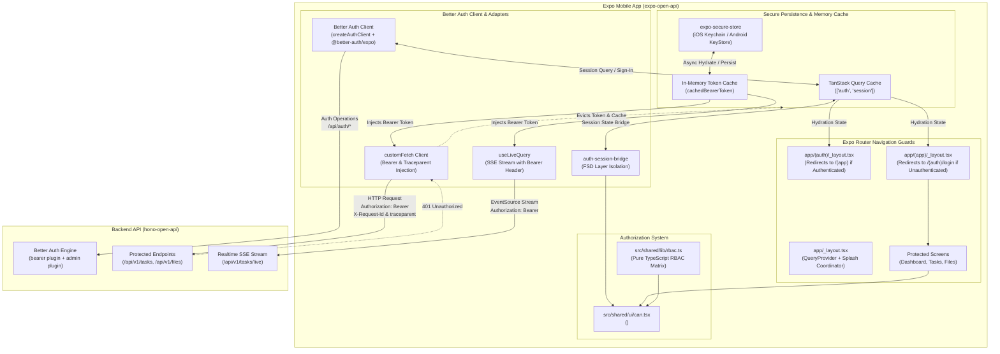
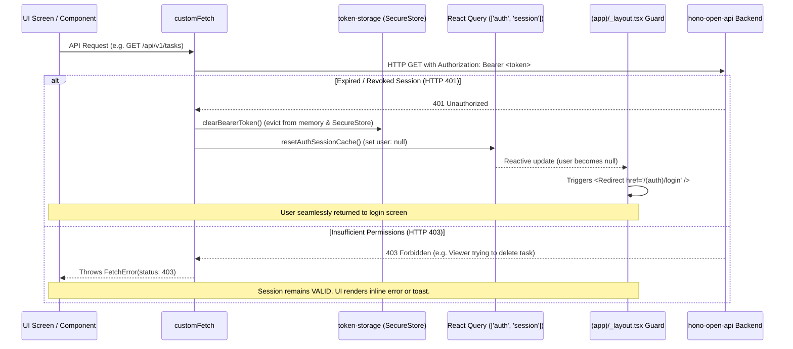

# Research: Better Auth Mobile Client (@better-auth/expo), SecureStore Bearer Token Management, and Mobile RBAC Route Guards

- **Issue Reference**: Resolves [#5](https://github.com/Guiguerreiro39/expo-open-api/issues/5)
- **Parent Epic**: Part of Wayfinder [#1](https://github.com/Guiguerreiro39/expo-open-api/issues/1)
- **Feeds Decision**: Directly feeds decision ticket [#10](https://github.com/Guiguerreiro39/expo-open-api/issues/10) ("Decide Better Auth client integration, SecureStore bearer token flow, and mobile route guards / RBAC")
- **Cross-Reference**:
  - Web frontend reference: [`tanstack-open-api/src/features/auth/`](https://github.com/Guiguerreiro39/tanstack-open-api/tree/main/src/features/auth), [`tanstack-open-api/src/routes/_app.tsx`](https://github.com/Guiguerreiro39/tanstack-open-api/blob/main/src/routes/_app.tsx), and [`tanstack-open-api/src/shared/lib/rbac.ts`](https://github.com/Guiguerreiro39/tanstack-open-api/blob/main/src/shared/lib/rbac.ts)
  - Backend reference: [`hono-open-api/src/infra/auth/index.ts`](https://github.com/Guiguerreiro39/hono-open-api/blob/main/src/infra/auth/index.ts), [`hono-open-api/src/core/auth/permissions.ts`](https://github.com/Guiguerreiro39/hono-open-api/blob/main/src/core/auth/permissions.ts), and [`hono-open-api/src/core/auth/middlewares.ts`](https://github.com/Guiguerreiro39/hono-open-api/blob/main/src/core/auth/middlewares.ts)

---

## 1. Executive Summary

Mobile client authentication diverges substantially from web browser environments. While web applications rely on transparent, browser-managed HTTP cookies via `credentials: "include"`, native mobile applications running on **Expo SDK 52+ (React Native 0.76+ with Hermes and New Architecture)** do not possess a unified browser cookie jar shared automatically across arbitrary network requests (`fetch`, `XMLHttpRequest`, SSE streaming, and native background uploaders).

In native mobile runtimes:
1. **Network Boundary**: Plain `fetch()` calls in React Native do not automatically persist or attach `Set-Cookie` headers across disparate domains or subdomains unless backed by native cookie interceptors or explicitly supplied in request headers.
2. **Credential Persistence**: Credential storage requires hardware-backed cryptographic vaults—namely the **iOS Keychain** via `kSecClassGenericPassword` and the **Android KeyStore** via `EncryptedSharedPreferences`—exposed asynchronously in Expo via `expo-secure-store`.
3. **Transport Protocol**: Mobile architectures require standard **RFC 6750 `Authorization: Bearer <token>`** transport for stateless API communication, background file uploads, and Server-Sent Events (SSE) streaming connections (`/api/v1/tasks/live`), where passing credentials via URL query parameters is strictly prohibited.
4. **Navigation Lifecycle**: Routing is managed natively via **Expo Router v4** file-based routing (`app/(app)/_layout.tsx` vs `app/(auth)/_layout.tsx`), requiring synchronous layout guarding coordinated with `expo-splash-screen` to eliminate visual "auth flash" while session state hydrates.
5. **Authorization (RBAC)**: Fine-grained Role-Based Access Control (`admin`, `member`, `viewer`) and Resource Scope (`own` vs `all`) must be enforced declaratively via `<Can />` components and imperatively via RBAC hooks, adhering strictly to **Feature-Sliced Design (FSD)** layer boundaries using an auth-session bridge.



This research establishes the exact specifications, interfaces, and migration strategies required to port `tanstack-open-api`'s auth and authorization pillars to `expo-open-api`.

---

## 2. `@better-auth/expo` Setup and Token Transport Architecture

### 2.1 The Mobile Dual-Storage Reality: Cookies vs. Bearer Tokens

In `tanstack-open-api`, authentication relies on browser-native cookies configured with `httpOnly: true`, `sameSite: "lax"`, and `credentials: "include"`. On mobile React Native, standard web cookies introduce severe operational friction:

| Dimension | Web Browser (`tanstack-open-api`) | Mobile React Native (`expo-open-api`) |
| :--- | :--- | :--- |
| **Cookie Storage** | Handled natively by browser engine (WebKit, Blink, Gecko). | No default cookie jar for general `fetch()` requests without native bridging. |
| **Cross-Origin Requests** | Handled via CORS `Access-Control-Allow-Credentials: true`. | Mobile apps do not have browser-enforced origin restrictions, but servers require explicit trusted schemes. |
| **Hardware Encryption** | Browser profiles or OS keyrings (opaque to JS). | Hardware-backed KeyStore (Android) / Keychain (iOS) via `expo-secure-store`. |
| **Realtime SSE (`EventSource`)** | Browser attaches cookies to `EventSource` automatically. | React Native requires custom request headers (`Authorization: Bearer <token>`) on the stream. |
| **File Transfers (Multipart)** | Browser attaches session cookies to multipart POSTs. | Mobile native uploaders (`expo-file-system`) require explicit `Authorization` headers. |

#### Architectural Resolution: The Hybrid Mobile Auth Pattern
`hono-open-api`'s Better Auth instance is configured with both the `admin` plugin and the `bearer()` plugin:
```typescript
// hono-open-api/src/infra/auth/index.ts (lines 81-90)
plugins: [
  admin({ ac, roles }),
  bearer(),
  openAPI({ disableDefaultReference: true }),
]
```

Because `hono-open-api` enables `bearer()`, Better Auth's `auth.api.getSession({ headers })` validates sessions from **both** `headers.cookie` and `headers.authorization: Bearer <session-token>`. Furthermore, when a user signs in, Better Auth returns the session token in the response headers under `set-auth-token`, and the session object itself contains `session.token`.

Therefore, `expo-open-api` adopts a **Hybrid Mobile Auth Pattern**:
1. **Auth Lifecycle via `@better-auth/expo`**: The auth client uses `@better-auth/expo/client` configured with `storage: SecureStore` to manage session creation, social OAuth deep linking, email/password authentication, and cookie extraction.
2. **API & Streaming Transport via Bearer Tokens**: All API requests (`customFetch`), multipart file uploads (`expo-file-system`), and SSE subscriptions (`useLiveQuery`) transport credentials strictly via `Authorization: Bearer <token>`.

---

### 2.2 Client Configuration (`src/features/auth/api/client.ts`)

In `expo-open-api`, the auth client is initialized with the official `@better-auth/expo/client` plugin, securely integrated with `expo-secure-store`:

```typescript
// src/features/auth/api/client.ts
import { createAuthClient } from "better-auth/react";
import { expoClient } from "@better-auth/expo/client";
import * as SecureStore from "expo-secure-store";
import Constants from "expo-constants";
import { resolveApiUrl } from "@/shared/config/env";
import { setBearerToken, clearBearerToken } from "@/features/auth/lib/token-storage";

// Retrieve custom deep linking scheme from app configuration (e.g. "expo-open-api")
const appScheme = Constants.expoConfig?.scheme ?? "expo-open-api";

export const authClient = createAuthClient({
  baseURL: resolveApiUrl(),
  fetchOptions: {
    // Intercept responses from Better Auth to mirror session tokens into memory & SecureStore
    onSuccess: async (ctx) => {
      const authToken = ctx.response.headers.get("set-auth-token");
      if (authToken) {
        await setBearerToken(authToken);
      }
    },
    onError: async (ctx) => {
      if (ctx.response.status === 401) {
        await clearBearerToken();
      }
    },
  },
  sessionOptions: {
    refetchOnWindowFocus: false, // Handled via AppState in React Native
    refetchInterval: 0,
  },
  plugins: [
    expoClient({
      scheme: appScheme,
      storagePrefix: "expo_open_api",
      storage: SecureStore,
    }),
  ],
});

export const { signIn, signUp, signOut, useSession } = authClient;
```

#### Key Store Constraints & Sanitization
`expo-secure-store` enforces strict key naming rules:
- Keys may only contain alphanumeric characters (`[a-zA-Z0-9]`), `.`, `-`, and `_`.
- Colons (`:`) and slashes (`/`), commonly generated by storage frameworks, will trigger an uncaught native exception (`Invalid key provided to SecureStore`).
- The `storagePrefix: "expo_open_api"` parameter ensures all generated keys comply with native OS KeyStore/Keychain storage rules.

---

### 2.3 Token Storage & In-Memory Caching (`src/features/auth/lib/token-storage.ts`)

Reading from `expo-secure-store` on every single HTTP request introduces significant latency:
- On iOS, `SecItemCopyMatching` triggers an asynchronous IPC call to the `securityd` daemon and keychain decryption.
- On Android, `EncryptedSharedPreferences` requires hardware KeyStore keystore decryption and file read.
- This introduces 5ms to 25ms of latency per outbound fetch request, which cascades when executing concurrent API calls or rendering data-dense screens.

To achieve maximum mobile performance, `expo-open-api` implements an **In-Memory Token Cache** with atomic SecureStore synchronization:

```typescript
// src/features/auth/lib/token-storage.ts
import * as SecureStore from "expo-secure-store";

const SECURE_STORE_TOKEN_KEY = "expo_open_api_bearer_token";

// In-memory token cache to prevent repeated Keychain/KeyStore reads during requests
let cachedBearerToken: string | null = null;
let isHydrated = false;
let hydrationPromise: Promise<string | null> | null = null;

/**
 * Initializes the in-memory token cache from SecureStore during app bootstrap.
 * Safe for concurrent invocation; returns the existing hydration promise if in flight.
 */
export async function hydrateTokenStorage(): Promise<string | null> {
  if (isHydrated) {
    return cachedBearerToken;
  }

  if (hydrationPromise) {
    return hydrationPromise;
  }

  hydrationPromise = (async () => {
    try {
      const stored = await SecureStore.getItemAsync(SECURE_STORE_TOKEN_KEY);
      cachedBearerToken = stored;
      isHydrated = true;
      return stored;
    } catch (error) {
      console.warn("[token-storage] Failed to read token from SecureStore:", error);
      cachedBearerToken = null;
      isHydrated = true;
      return null;
    } finally {
      hydrationPromise = null;
    }
  })();

  return hydrationPromise;
}

/**
 * Synchronous getter for the cached bearer token.
 * Returns null if not yet hydrated or unauthenticated.
 */
export function getCachedBearerToken(): string | null {
  return cachedBearerToken;
}

/**
 * Asynchronous getter guaranteeing token hydration before return.
 */
export async function getBearerToken(): Promise<string | null> {
  if (!isHydrated) {
    return hydrateTokenStorage();
  }
  return cachedBearerToken;
}

/**
 * Updates both the in-memory cache and native SecureStore.
 */
export async function setBearerToken(token: string): Promise<void> {
  cachedBearerToken = token;
  isHydrated = true;
  try {
    await SecureStore.setItemAsync(SECURE_STORE_TOKEN_KEY, token, {
      keychainAccessible: SecureStore.AFTER_FIRST_UNLOCK,
    });
  } catch (error) {
    console.error("[token-storage] Failed to persist bearer token to SecureStore:", error);
  }
}

/**
 * Evicts the bearer token from memory and native SecureStore.
 */
export async function clearBearerToken(): Promise<void> {
  cachedBearerToken = null;
  isHydrated = true;
  try {
    await SecureStore.deleteItemAsync(SECURE_STORE_TOKEN_KEY);
  } catch (error) {
    console.error("[token-storage] Failed to clear bearer token from SecureStore:", error);
  }
}
```

---

### 2.4 Token Injection in `customFetch` (`src/shared/api/fetch.ts`)

The mobile `customFetch` client injects the cached Bearer token into every request, along with W3C `traceparent` and `X-Request-Id` headers:

```typescript
// src/shared/api/fetch.ts
import { resolveApiUrl } from "@/shared/config/env";
import { getCachedBearerToken, getBearerToken, clearBearerToken } from "@/features/auth/lib/token-storage";
import { resetAuthSessionCache } from "@/shared/lib/auth-session-bridge";

export interface CustomFetchOptions extends RequestInit {
  responseType?: "json" | "blob" | "text";
}

export class FetchError extends Error {
  readonly status: number;
  readonly code?: string;
  readonly requestId?: string;
  readonly traceId?: string;
  readonly details?: unknown;

  constructor(options: {
    status: number;
    message: string;
    code?: string;
    requestId?: string;
    traceId?: string;
    details?: unknown;
  }) {
    super(options.message);
    this.name = "FetchError";
    this.status = options.status;
    this.code = options.code;
    this.requestId = options.requestId;
    this.traceId = options.traceId;
    this.details = options.details;
  }
}

export async function customFetch<T>(url: string, options: CustomFetchOptions = {}): Promise<T> {
  const fullUrl = resolveApiUrl(url);
  const headers = new Headers(options.headers);

  // 1. Content-Type Header
  const isFormData = typeof FormData !== "undefined" && options.body instanceof FormData;
  if (!isFormData && !headers.has("Content-Type")) {
    headers.set("Content-Type", "application/json");
  }

  // 2. Bearer Token Injection
  if (!headers.has("Authorization")) {
    let token = getCachedBearerToken();
    if (!token) {
      token = await getBearerToken();
    }
    if (token) {
      headers.set("Authorization", `Bearer ${token}`);
    }
  }

  // 3. Distributed Tracing Headers (W3C traceparent & X-Request-Id)
  const outboundRequestId = headers.get("X-Request-Id") ?? `req_${crypto.randomUUID()}`;
  headers.set("X-Request-Id", outboundRequestId);

  const response = await fetch(fullUrl, {
    ...options,
    headers,
  });

  // 4. Global 401 Interception
  if (response.status === 401) {
    await clearBearerToken();
    resetAuthSessionCache();
  }

  if (!response.ok) {
    let errorData: any;
    try {
      errorData = await response.json();
    } catch {
      errorData = { message: response.statusText || `HTTP ${response.status}` };
    }

    throw new FetchError({
      status: response.status,
      code: errorData?.error?.code,
      message: errorData?.error?.message || errorData?.message || `HTTP ${response.status}`,
      requestId: errorData?.error?.requestId ?? outboundRequestId,
      details: errorData?.error?.details,
    });
  }

  if (response.status === 204) {
    return undefined as unknown as T;
  }

  return response.json() as Promise<T>;
}
```

---

### 2.5 Realtime SSE Token Injection (`useLiveQuery`)

Unlike web browsers which attach cookies to native `EventSource`, React Native requires an SSE client supporting custom request headers (such as `react-native-sse` or `fetch` stream + `eventsource-parser`):

```typescript
// src/shared/lib/hooks/use-live-query.ts (Token Injection Pattern)
import { getCachedBearerToken, getBearerToken } from "@/features/auth/lib/token-storage";
import EventSource from "react-native-sse";

export async function createAuthenticatedEventSource(url: string) {
  let token = getCachedBearerToken();
  if (!token) {
    token = await getBearerToken();
  }

  const es = new EventSource(url, {
    headers: {
      Accept: "text/event-stream",
      ...(token ? { Authorization: `Bearer ${token}` } : {}),
    },
    pollingInterval: 0,
  });

  return es;
}
```
> [!IMPORTANT]
> Passing the token via URL query string (`/api/v1/tasks/live?token=...`) is strictly prohibited. Query parameters leak sensitive bearer tokens into access logs, web proxies, and observability spans. Outbound SSE requests must use request headers.

---

### 2.6 Session Query & AppState Revalidation (`src/features/auth/api/session.ts`)

In `expo-open-api`, the session query verifies the user against `hono-open-api` and syncs user context with the observability adapter:

```typescript
// src/features/auth/api/session.ts
import { queryOptions, useQuery, type QueryClient } from "@tanstack/react-query";
import { Schema } from "effect";
import { authClient } from "./client";
import { setBearerToken, clearBearerToken } from "../lib/token-storage";
import { registerAuthSessionQueryOptions } from "@/shared/lib/auth-session-bridge";
import type { ObservabilityService } from "@/shared/observability";

export const AuthUserSchema = Schema.Struct({
  id: Schema.String,
  name: Schema.String,
  email: Schema.String,
  emailVerified: Schema.optionalWith(Schema.Boolean, { default: () => false }),
  role: Schema.optionalWith(Schema.String, { default: () => "viewer" }),
  image: Schema.optionalWith(Schema.NullOr(Schema.String), { default: () => null }),
});

export const AuthSessionDataSchema = Schema.Struct({
  id: Schema.String,
  userId: Schema.String,
  token: Schema.optional(Schema.String),
  expiresAt: Schema.optional(Schema.Union(Schema.DateFromSelf, Schema.String)),
});

export const AuthEnvelopeSchema = Schema.Struct({
  user: AuthUserSchema,
  session: AuthSessionDataSchema,
});

export type AuthUser = Schema.Schema.Type<typeof AuthUserSchema>;
export type AuthSessionData = Schema.Schema.Type<typeof AuthSessionDataSchema>;
export type AuthEnvelope = Schema.Schema.Type<typeof AuthEnvelopeSchema>;

let activeObservability: ObservabilityService | null = null;

export function registerAuthObservability(obs: ObservabilityService | null): void {
  activeObservability = obs;
}

export function syncObservabilityUser(user: AuthUser | null): void {
  if (!activeObservability) return;
  if (user) {
    activeObservability.setUserContext({
      id: user.id,
      email: user.email,
      role: user.role,
    });
  } else {
    activeObservability.clearUserContext();
  }
}

export const authSessionQueryOptions = queryOptions({
  queryKey: ["auth", "session"] as const,
  queryFn: async (): Promise<AuthEnvelope | null> => {
    try {
      const res = await authClient.getSession();
      if (res.error || !res.data?.user || !res.data?.session) {
        await clearBearerToken();
        syncObservabilityUser(null);
        return null;
      }

      const decoded = Schema.decodeUnknownSync(AuthEnvelopeSchema)(res.data);
      if (decoded.session.token) {
        await setBearerToken(decoded.session.token);
      }

      syncObservabilityUser(decoded.user);
      return decoded;
    } catch {
      await clearBearerToken();
      syncObservabilityUser(null);
      return null;
    }
  },
  staleTime: 5 * 60 * 1000,
  gcTime: 30 * 60 * 1000,
});

registerAuthSessionQueryOptions(authSessionQueryOptions);

export function useAuthSession() {
  const query = useQuery(authSessionQueryOptions);
  return {
    session: query.data?.session ?? null,
    user: query.data?.user ?? null,
    isLoading: query.isLoading,
    isAuthenticated: Boolean(query.data?.user),
    error: query.error,
    refetch: query.refetch,
  };
}

export async function invalidateAuthSession(queryClient: QueryClient): Promise<void> {
  await clearBearerToken();
  queryClient.setQueryData(authSessionQueryOptions.queryKey, null);
  await queryClient.invalidateQueries({ queryKey: authSessionQueryOptions.queryKey });
}
```

---

## 3. Mobile Route Guarding Implementation with Expo Router

### 3.1 Layout Group Architecture: `(app)` vs `(auth)`

Expo Router v4 organizes routes using pathless route groups:
```text
app/
├── _layout.tsx           # Global Root: TanStack Query Provider & Splash Coordinator
├── (auth)/               # Public / Unauthenticated Flow
│   ├── _layout.tsx       # Auth Stack: Redirects to /(app) if user is already logged in
│   ├── login.tsx         # Sign-in screen (Email/Password, Social)
│   └── register.tsx      # Sign-up screen
└── (app)/                # Protected App Flow
    ├── _layout.tsx       # App Stack / Tabs: Redirects to /(auth)/login if unauthenticated
    ├── index.tsx         # Dashboard / Task List
    ├── tasks/
    └── files/
```

#### Comparison: Expo Router v4 Layout Redirects vs Expo Router v5 `Stack.Protected`
- **Expo Router v5 (Expo SDK 53 Preview)** introduces declarative `Stack.Protected guard={isLoggedIn}`.
- **Expo Router v4 (Expo SDK 52 Production)** uses declarative `<Redirect href="..." />` inside the layout group component.
- The layout redirect pattern is universally compatible, fully testable with React Native Testing Library, and immune to navigation history leaks.

---

### 3.2 Eliminating the "Auth Flash" with `expo-splash-screen`

A common defect in mobile apps is the **Auth Flash**: the login screen briefly flashes while SecureStore and the initial session query are loading from disk/network.

To eliminate this entirely, the root layout coordinates the native OS splash screen with React Query's hydration state:

```tsx
// app/_layout.tsx
import * as React from "react";
import { Stack } from "expo-router";
import * as SplashScreen from "expo-splash-screen";
import { QueryClientProvider } from "@tanstack/react-query";
import { getAppQueryClient } from "@/shared/api/query-client";
import { hydrateTokenStorage } from "@/features/auth/lib/token-storage";
import { useAuthSession } from "@/features/auth/api/session";

// Prevent native splash screen from hiding automatically until credentials & session are verified
SplashScreen.preventAutoHideAsync().catch(() => {});

function RootNavigator() {
  const { isLoading } = useAuthSession();

  React.useEffect(() => {
    if (!isLoading) {
      // Hide splash screen smoothly once the session status is determined
      SplashScreen.hideAsync().catch(() => {});
    }
  }, [isLoading]);

  if (isLoading) {
    // Keep rendering null while splash screen covers the window
    return null;
  }

  return (
    <Stack screenOptions={{ headerShown: false }}>
      <Stack.Screen name="(app)" />
      <Stack.Screen name="(auth)" />
    </Stack>
  );
}

export default function RootLayout() {
  const [queryClient] = React.useState(() => getAppQueryClient());

  React.useEffect(() => {
    // Warm up the token cache on mount
    hydrateTokenStorage();
  }, []);

  return (
    <QueryClientProvider client={queryClient}>
      <RootNavigator />
    </QueryClientProvider>
  );
}
```

---

### 3.3 Protected App Layout (`app/(app)/_layout.tsx`)

The protected layout verifies authentication before mounting any child screens:

```tsx
// app/(app)/_layout.tsx
import * as React from "react";
import { Redirect, Stack } from "expo-router";
import { useAuthSession } from "@/features/auth/api/session";
import { View, ActivityIndicator } from "react-native";

export default function AppLayout() {
  const { user, isLoading } = useAuthSession();

  // 1. Wait for initial session query to settle
  if (isLoading) {
    return (
      <View className="flex-1 items-center justify-center bg-background">
        <ActivityIndicator size="large" />
      </View>
    );
  }

  // 2. If unauthenticated, redirect to the login screen
  if (!user) {
    return <Redirect href="/(auth)/login" />;
  }

  // 3. Render protected navigation stack (or Tabs)
  return (
    <Stack screenOptions={{ headerShown: false }}>
      <Stack.Screen name="index" options={{ title: "Dashboard" }} />
      <Stack.Screen name="tasks" />
      <Stack.Screen name="files" />
    </Stack>
  );
}
```

---

### 3.4 Public Auth Layout (`app/(auth)/_layout.tsx`)

The auth layout bounces already-authenticated users back into the app:

```tsx
// app/(auth)/_layout.tsx
import * as React from "react";
import { Redirect, Stack } from "expo-router";
import { useAuthSession } from "@/features/auth/api/session";

export default function AuthLayout() {
  const { user, isLoading } = useAuthSession();

  if (isLoading) {
    return null;
  }

  // If already authenticated, redirect away from login/register to the main app
  if (user) {
    return <Redirect href="/(app)" />;
  }

  return (
    <Stack screenOptions={{ headerShown: false }}>
      <Stack.Screen name="login" options={{ title: "Sign In" }} />
      <Stack.Screen name="register" options={{ title: "Create Account" }} />
    </Stack>
  );
}
```

---

### 3.5 Handling HTTP 401 Unauthorized vs. HTTP 403 Forbidden

The application handles 401 and 403 errors with distinct disciplines:



- **HTTP 401 (Authentication Failure)**: Credentials missing, invalid, expired, or revoked. The application evicts the token from SecureStore, clears query cache, and transitions the user to `/(auth)/login`.
- **HTTP 403 (Authorization Failure)**: Authentication is valid, but the user lacks permission for the specific action or resource. The session remains active; the screen displays an inline banner or toast notification without redirecting.

---

## 4. Mobile `<Can />` and RBAC Authorization Design

### 4.1 Pure TypeScript RBAC Matrix (`src/shared/lib/rbac.ts`)

The RBAC implementation from `tanstack-open-api` is 100% pure TypeScript. Because it does not interact with the DOM or Node runtime APIs, it ports directly to React Native and Hermes without modification:

```typescript
// src/shared/lib/rbac.ts
import { createAccessControl } from "better-auth/plugins/access";
import { adminAc, defaultStatements, userAc } from "better-auth/plugins/admin/access";

export type AppRole = "admin" | "member" | "viewer";
export type ResourceScope = "own" | "all";

export interface RbacUser {
  id?: string;
  role?: string | null;
  [key: string]: unknown;
}

export interface ResourceSubject {
  id?: string;
  userId?: string | null;
  ownerId?: string | null;
  type?: string;
  scope?: ResourceScope;
  [key: string]: unknown;
}

export const RBAC_STATEMENTS = {
  user: [
    "create", "list", "set-role", "ban", "impersonate",
    "delete", "set-password", "set-email", "get", "update",
  ],
  session: ["list", "revoke", "delete"],
  task: ["create", "read", "read:any", "update", "update:any", "delete", "delete:any"],
  file: ["create", "read", "read:any", "delete", "delete:any"],
} as const;

export const ROLE_STATEMENTS = {
  admin: {
    user: ["create", "list", "set-role", "ban", "impersonate", "delete", "set-password", "set-email", "get", "update"],
    session: ["list", "revoke", "delete"],
    task: ["create", "read", "read:any", "update", "update:any", "delete", "delete:any"],
    file: ["create", "read", "read:any", "delete", "delete:any"],
  },
  member: {
    user: ["get", "update"],
    session: ["list", "revoke"],
    task: ["create", "read", "update", "delete"],
    file: ["create", "read", "delete"],
  },
  viewer: {
    user: ["get"],
    session: ["list"],
    task: ["read"],
    file: ["read"],
  },
} as const;

export const accessControl = createAccessControl({
  ...defaultStatements,
  ...RBAC_STATEMENTS,
} as const);

export const accessRoles = {
  admin: accessControl.newRole({ ...adminAc.statements, ...ROLE_STATEMENTS.admin }),
  member: accessControl.newRole({ ...userAc.statements, ...ROLE_STATEMENTS.member }),
  viewer: accessControl.newRole({ ...ROLE_STATEMENTS.viewer }),
};

export function normalizeRole(role?: string | null): AppRole {
  if (!role) return "viewer";
  const clean = role.toLowerCase().trim();
  if (clean === "admin") return "admin";
  if (clean === "member" || clean === "user") return "member";
  return "viewer";
}

export function isAdmin(userOrRole?: RbacUser | string | null): boolean {
  if (!userOrRole) return false;
  const role = typeof userOrRole === "string" ? userOrRole : userOrRole.role;
  return normalizeRole(role) === "admin";
}

export function hasRole(userOrRole: RbacUser | string | null | undefined, targetRole: AppRole): boolean {
  if (!userOrRole) return false;
  const current = typeof userOrRole === "string" ? normalizeRole(userOrRole) : normalizeRole(userOrRole.role);
  return current === targetRole;
}

export interface HasPermissionOptions {
  role?: AppRole | string | null;
  user?: RbacUser | null;
  resource?: string | ResourceSubject | null;
  action: string;
}

export function hasPermission({ role, user, resource, action }: HasPermissionOptions): boolean {
  if (!role && !user) return false;
  const effectiveRole = normalizeRole(role ?? user?.role);

  // Admin bypasses all checks
  if (effectiveRole === "admin") return true;

  // Viewers are strictly read-only
  if (effectiveRole === "viewer") {
    return action === "read" || action === "get" || action === "list";
  }

  // Parse resource type and ownership
  let resourceType: string | undefined;
  let ownerId: string | undefined;
  let scope: ResourceScope = "own";

  if (typeof resource === "string") {
    resourceType = resource.replace(/s$/, "");
  } else if (resource && typeof resource === "object") {
    resourceType = resource.type ?? (resource.id?.startsWith("task") ? "task" : resource.id?.startsWith("file") ? "file" : undefined);
    ownerId = resource.userId ?? resource.ownerId ?? undefined;
    scope = resource.scope ?? "own";
  }

  let effectiveAction = action;
  if (effectiveAction.includes(":")) {
    const parts = effectiveAction.split(":");
    const possibleResource = parts[0].replace(/s$/, "");
    if (["user", "session", "task", "file"].includes(possibleResource)) {
      if (!resourceType) resourceType = possibleResource;
      effectiveAction = parts.slice(1).join(":");
    }
  }

  // Ownership verification for members
  if (ownerId && user?.id && ownerId !== user.id) {
    if (!effectiveAction.endsWith(":any")) {
      return false;
    }
  }

  const statementsForRole = ROLE_STATEMENTS[effectiveRole];
  if (!statementsForRole) return false;

  if (resourceType && resourceType in statementsForRole) {
    const actions = (statementsForRole as Record<string, readonly string[]>)[resourceType];
    return actions.includes(effectiveAction);
  }

  if (effectiveAction.endsWith(":any")) return false;

  if (effectiveRole === "member") {
    if (scope === "all" && effectiveAction !== "read") return false;
    return ["create", "read", "update", "delete", "get", "list"].includes(effectiveAction);
  }

  return false;
}
```

---

### 4.2 Cross-Layer Bridge Pattern (`src/shared/lib/auth-session-bridge.ts`)

In Feature-Sliced Design (FSD), modules located inside `src/shared/ui/` (such as `<Can />`) are forbidden from importing from feature slices (such as `src/features/auth/api/session.ts`). To allow `<Can />` to access the current session without violating Biome's `style/noRestrictedImports` rule, `expo-open-api` preserves the **Auth Session Bridge**:

```typescript
// src/shared/lib/auth-session-bridge.ts
import { QueryClient, type UseQueryOptions } from "@tanstack/react-query";

export interface SessionData {
  user?: {
    id: string;
    name?: string;
    email?: string;
    role?: string;
    [key: string]: unknown;
  } | null;
  session?: unknown;
}

export type AuthSessionQueryOptions = UseQueryOptions<
  SessionData | null,
  unknown,
  SessionData | null,
  readonly ["auth", "session"]
>;

let sessionQueryOptions: AuthSessionQueryOptions | null = null;
const activeQueryClients = new Set<QueryClient>();

export function registerAuthSessionQueryOptions(options: unknown): void {
  sessionQueryOptions = options as AuthSessionQueryOptions;
}

export function getAuthSessionQueryOptions(): AuthSessionQueryOptions | null {
  return sessionQueryOptions;
}

export function registerQueryClient(client: QueryClient): () => void {
  activeQueryClients.add(client);
  return () => {
    activeQueryClients.delete(client);
  };
}

export function resetAuthSessionCache(): void {
  for (const client of activeQueryClients) {
    client.setQueryData(["auth", "session"], null);
  }
}
```

---

### 4.3 Mobile `<Can />` Component (`src/shared/ui/can.tsx`)

The `<Can />` component evaluates permissions and renders children or fallbacks using React Native primitives:

```tsx
// src/shared/ui/can.tsx
import * as React from "react";
import { useQuery, useQueryClient } from "@tanstack/react-query";
import {
  getAuthSessionQueryOptions,
  registerQueryClient,
  type SessionData,
} from "@/shared/lib/auth-session-bridge";
import {
  type AppRole,
  hasPermission,
  hasRole,
  type RbacUser,
  type ResourceSubject,
} from "@/shared/lib/rbac";

export interface CanProps {
  /** Required role to view children */
  role?: AppRole;
  /** Required action (e.g. "task:delete", "create") */
  action?: string;
  /** Target resource subject or string name */
  resource?: string | ResourceSubject | null;
  /** Explicit user override (defaults to current session user) */
  user?: RbacUser | null;
  /** Fallback to render if unauthorized (defaults to null) */
  fallback?: React.ReactNode;
  /** Content rendered when permission check passes */
  children: React.ReactNode;
}

export function Can({
  role,
  action,
  resource,
  user: directUser,
  fallback = null,
  children,
}: CanProps) {
  const queryClient = useQueryClient();

  React.useEffect(() => {
    return registerQueryClient(queryClient);
  }, [queryClient]);

  const bridgeOptions = getAuthSessionQueryOptions();
  const cachedSession = queryClient.getQueryData<SessionData>(["auth", "session"]);

  const { data: sessionData } = useQuery({
    queryKey: ["auth", "session"] as const,
    enabled: directUser === undefined,
    initialData: () => cachedSession ?? null,
    staleTime: typeof bridgeOptions?.staleTime === "number" ? bridgeOptions.staleTime : 5 * 60 * 1000,
    queryFn: bridgeOptions?.queryFn as never,
  }) as { data?: SessionData | null };

  const currentUser =
    directUser !== undefined
      ? directUser
      : ((sessionData?.user ?? cachedSession?.user ?? null) as RbacUser | null);

  // 1. Check role requirement
  if (role && !hasRole(currentUser, role)) {
    return <>{fallback}</>;
  }

  // 2. Check permission requirement
  if (action && !hasPermission({ user: currentUser, resource, action })) {
    return <>{fallback}</>;
  }

  return <>{children}</>;
}
```

#### Usage in Mobile Screens:
```tsx
// Example: Conditional UI rendering in a Task Detail screen
import { View, Text, Pressable } from "react-native";
import { Can } from "@/shared/ui/can";

export function TaskDetailActions({ task }: { task: TaskItem }) {
  return (
    <View className="flex-row gap-2">
      {/* Edit button: only owners or admins */}
      <Can action="task:update" resource={task}>
        <Pressable className="bg-primary px-4 py-2 rounded-md">
          <Text className="text-primary-foreground">Edit Task</Text>
        </Pressable>
      </Can>

      {/* Delete button: only admins or task owners */}
      <Can
        action="task:delete"
        resource={task}
        fallback={<Text className="text-xs text-muted-foreground">Read-only</Text>}
      >
        <Pressable className="bg-destructive px-4 py-2 rounded-md">
          <Text className="text-destructive-foreground">Delete Task</Text>
        </Pressable>
      </Can>
    </View>
  );
}
```

---

## 5. Edge Cases, Failure Modes, and Security Guardrails

### 5.1 Device Passcode & Biometric Key Invalidation
- **Issue**: On iOS and Android, changing the device passcode or enrolling a new fingerprint/face invalidates keychain items secured with strict biometric ACLs (`WHEN_PASSCODE_SET_THIS_DEVICE_ONLY`).
- **Mitigation**: Standard session tokens use `SecureStore.AFTER_FIRST_UNLOCK`. This allows session persistence across background app refreshes while still keeping credentials encrypted when the device is locked.

### 5.2 Offline Cache Bleed & Logout Sanitization
- **Issue**: TanStack Query persists query caches to disk (e.g. via `async-storage-persister`). If a user logs out, sensitive task queries may linger in offline disk storage, accessible upon app restart.
- **Mitigation**: When logging out or receiving an HTTP 401, `invalidateAuthSession()` executes:
  1. `clearBearerToken()` (erases KeyStore/Keychain).
  2. `queryClient.setQueryData(["auth", "session"], null)`.
  3. `queryClient.clear()` (erases all cached queries in memory and marks them for persister eviction).
  4. `syncObservabilityUser(null)`.

### 5.3 Deep Link Scheme Hijacking in OAuth
- **Issue**: On Android, custom URI schemes (`expo-open-api://`) can theoretically be claimed by other malicious apps installed on the device.
- **Mitigation**:
  1. Better Auth uses state tokens and PKCE parameters validated on the backend.
  2. In production builds, configure Android App Links (`https://app.example.com/.well-known/assetlinks.json`) and iOS Universal Links (`apple-app-site-association`) to guarantee domain ownership.

### 5.4 Token Leakage in Observability & Breadcrumbs
- **Issue**: Outbound HTTP breadcrumbs captured by Sentry or Datadog might record the raw `Authorization: Bearer <token>` header.
- **Mitigation**: The `ObservabilityService` network interceptor explicitly strips `Authorization`, `Cookie`, `set-auth-token`, and `set-cookie` headers before attaching network breadcrumbs.

---

## 6. Recommendations and Decision Matrix for Ticket #10

Based on this research, the following decisions are recommended for ticket [#10](https://github.com/Guiguerreiro39/expo-open-api/issues/10):

| Component / Area | Recommended Decision | Rationale |
| :--- | :--- | :--- |
| **Auth Client** | `createAuthClient` with `@better-auth/expo/client` plugin | Official Better Auth integration supporting Expo SDK 52+, deep links, and SecureStore. |
| **Credential Storage** | `expo-secure-store` with `storagePrefix: "expo_open_api"` | Complies with iOS Keychain and Android KeyStore key sanitization requirements. |
| **Token Transport** | RFC 6750 `Authorization: Bearer <token>` in `customFetch` & SSE | Seamless integration with `hono-open-api`'s `bearer()` plugin; eliminates cookie-jar sync issues in React Native. |
| **Token Caching** | In-memory token cache hydrated on bootstrap | Eliminates 5-25ms synchronous/asynchronous Keychain IPC overhead per API request. |
| **Route Guards** | Expo Router v4 layout groups `(app)/_layout.tsx` + `<Redirect />` | Standard, battle-tested pattern in Expo SDK 52; coordinates with `SplashScreen.preventAutoHideAsync()`. |
| **401 Handling** | Evict token from memory + SecureStore, reset React Query session | Triggers immediate, deterministic layout redirect to `/(auth)/login`. |
| **RBAC Matrix** | Port `tanstack-open-api`'s `src/shared/lib/rbac.ts` directly | 100% pure TypeScript; zero DOM dependencies; identical role statements (`admin`, `member`, `viewer`). |
| **`<Can />` Component** | Port `src/shared/ui/can.tsx` via `auth-session-bridge.ts` | Respects Feature-Sliced Design layer boundaries; provides declarative permission checks for React Native elements. |
| **Package Manifest** | Install `@better-auth/expo`, `expo-secure-store`, `react-native-sse` | Minimal footprint; fully compatible with Expo SDK 52 and Hermes New Architecture. |
