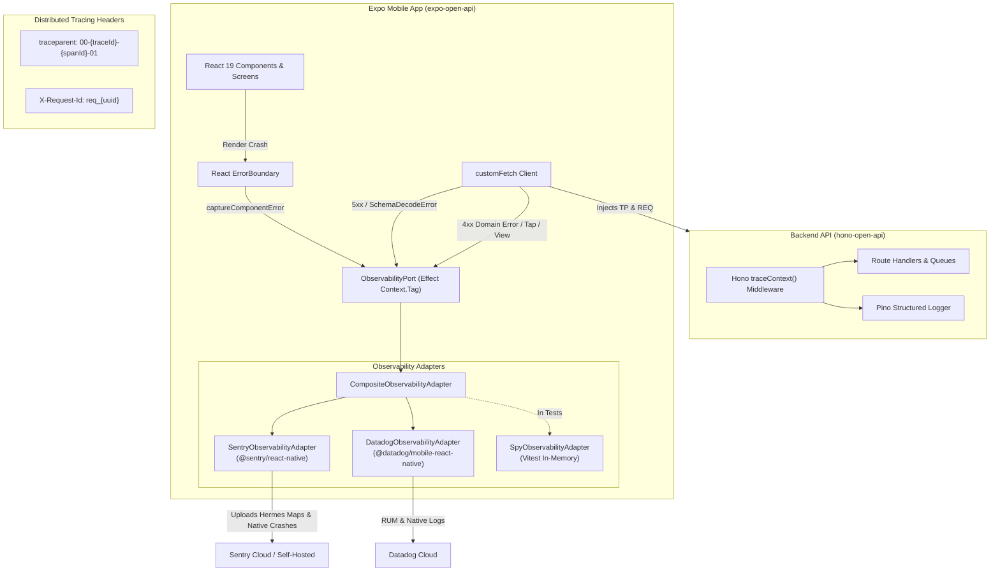

# Research: React Native Observability with Sentry Mobile, Datadog Mobile, W3C Trace Correlation, and Native Crash Tracking

- **Issue Reference**: Resolves [#6](https://github.com/Guiguerreiro39/expo-open-api/issues/6)
- **Parent Epic**: Part of Wayfinder [#1](https://github.com/Guiguerreiro39/expo-open-api/issues/1)
- **Feeds Decision**: Directly feeds decision ticket [#12](https://github.com/Guiguerreiro39/expo-open-api/issues/12) ("Decide mobile observability architecture, Sentry & Datadog Mobile adapter seams, and trace correlation")
- **Cross-Reference**: Aligns with web observability architecture in [`tanstack-open-api/src/shared/observability/`](https://github.com/Guiguerreiro39/tanstack-open-api/tree/main/src/shared/observability) and backend trace parsing in [`hono-open-api/src/core/observability/trace.ts`](https://github.com/Guiguerreiro39/hono-open-api/blob/main/src/core/observability/trace.ts)

---

## 1. Executive Summary

Mobile observability introduces failure modes that do not exist in web browsers. While web applications operate inside a sandboxed browser DOM where scripts run sequentially or via web workers, React Native mobile apps on **Expo SDK 52+ (New Architecture / React Native 0.76+)** operate across a dual-runtime boundary:
1. **The JavaScript / Hermes Engine Runtime**: Executing Hermes Ahead-Of-Time (AOT) bytecode, managing React 19 fiber reconciliations, component lifecycles, and UI state.
2. **The Native OS Runtime**: Executing native C++, Swift/Objective-C (iOS), and Kotlin/Java (Android) code via JSI (JavaScript Interface), TurboModules, and Fabric native components.

In this environment, an unhandled error is not merely a console error or a blank page—it can be a fatal native SIGSEGV crash, an Android ANR (Application Not Responding) UI freeze, a native memory exhaustion (OOM), or an unhandled Hermes bytecode exception that instantly terminates the application process.



To maintain production excellence without coupling the codebase to proprietary monitoring vendors, `expo-open-api` must replicate the **Hexagonal Observability Architecture** proven in `tanstack-open-api`:
- **Driver-Agnostic Port (`ObservabilityPort`)**: The application code (components, hooks, API clients, route handlers) speaks exclusively to an abstract `ObservabilityService` interface. No vendor SDK imports (`@sentry/react-native` or `@datadog/mobile-react-native`) are permitted outside the adapter layer.
- **Defect vs. Breadcrumb Taxonomy**: Rigid boundary separating unexpected technical failures (HTTP 5xx, `SchemaDecodeError`, unhandled native/JS crashes) which are captured as **Defects**, from expected domain outcomes (HTTP 4xx status codes, user gestures, screen views, network transitions) which are recorded strictly as **Breadcrumbs** with PII sanitization.
- **W3C Distributed Trace Correlation**: Seamless propagation of W3C `traceparent` (`00-<trace_id>-<span_id>-01`) and `X-Request-Id` headers from mobile `customFetch` into `hono-open-api` backend spans and Pino logs, enabling instant root-cause analysis from a mobile defect to backend microservices.
- **Zero-Dependency Testing & Development Fallbacks**: In Vitest harnesses, `SpyObservabilityAdapter` captures defects and breadcrumbs in-memory with zero network or native overhead. In local development without vendor credentials, `ConsoleObservabilityAdapter` or `NoopObservabilityAdapter` activates automatically.

---

## 2. SDK Comparison, Expo Plugin Configuration, and Hermes Symbolication

### 2.1 Feature & Capability Comparison

| Feature / Dimension | `@sentry/react-native` | `@datadog/mobile-react-native` | Zero-Dep Adapters (`Spy` / `Console`) |
| :--- | :--- | :--- | :--- |
| **Primary Focus** | Error tracking, crash forensics, performance profiling, release health | Full-stack APM, RUM, session replay, log analytics | Fast deterministic unit/component tests, zero-overhead dev |
| **Expo SDK 52 Support** | First-class via `@sentry/react-native/expo` plugin | First-class via `@datadog/mobile-react-native` plugin | Native JS, zero dependencies |
| **New Architecture (0.76+)** | Fully compatible (C++ TurboModules, Fabric) | Fully compatible (v2.x supports New Architecture) | N/A (Pure JS/TypeScript) |
| **Hermes Bytecode Symbolication** | Automatic via Expo config plugin & EAS Build | Supported via `@datadog/datadog-ci` in EAS build hooks | N/A |
| **Native Crash Reporting** | Sentry Cocoa (iOS) & Sentry Android SDKs | Datadog iOS & Android Native SDKs | None (in-memory mock) |
| **ANR / App Hang Detection** | Built-in (Android ANR watchdog, iOS App Hangs) | Built-in (Fatal & Non-Fatal ANR, App Hangs) | None |
| **Session Replay** | Mobile Session Replay (masks text, inputs, media) | Mobile Session Replay (mask all / allow list) | None |
| **Navigation Instrumentation** | `reactNavigationIntegration` (Expo Router ref) | `DdRumReactNavigationTracking` (Expo Router ref) | Route recorder array |
| **Network Auto-Instrumentation** | Native / Fetch wrapping with `tracePropagationTargets` | Native / Fetch wrapping with `allowedTracingUrls` | Custom fetch spy |
| **Offline Crash Queuing** | Local disk SQLite / file queue, flushed on restart | Local disk file queue, flushed on restart | In-memory array |
| **Pricing / Model** | Developer-friendly tier, open-source server option | Enterprise consumption tier (per session / ingested log) | Open Source / Free |

### 2.2 Expo Config Plugin Setup (SDK 52+)

Both Sentry and Datadog require native modifications during `npx expo prebuild` (or during cloud builds on EAS Build). Because `expo-open-api` adopts Continuous Native Generation (CNG), native directories (`ios/`, `android/`) are generated deterministically and never committed to git. All native setup is managed through Expo Config Plugins.

#### A. Sentry Config Plugin Configuration

In `app.config.ts`:

```typescript
import type { ExpoConfig, ConfigContext } from "expo/config";

export default ({ config }: ConfigContext): ExpoConfig => ({
  ...config,
  name: "expo-open-api",
  slug: "expo-open-api",
  version: "1.0.0",
  orientation: "portrait",
  plugins: [
    "expo-router",
    "expo-secure-store",
    [
      "@sentry/react-native/expo",
      {
        organization: process.env.SENTRY_ORG ?? "my-organization",
        project: process.env.SENTRY_PROJECT ?? "expo-open-api-mobile",
        url: process.env.SENTRY_URL ?? "https://sentry.io/",
      },
    ],
  ],
});
```

**What the Sentry plugin executes during Prebuild:**
- **iOS**: Injects a Run Script build phase into the Xcode project (`Upload Debug Symbols to Sentry`) using `@sentry/cli`, uploads dSYM files for native code, and patches the CocoaPods `Podfile` to link Sentry Cocoa SDK.
- **Android**: Applies `io.sentry.android.gradle` plugin to `android/app/build.gradle`, configures ProGuard/R8 deobfuscation file uploads, NDK symbols, and generates `sentry.properties`.
- **EAS Build**: When building on EAS with `SENTRY_AUTH_TOKEN`, `SENTRY_ORG`, and `SENTRY_PROJECT` in environment secrets, EAS Build automatically executes source map generation and symbolication uploads.

#### B. Datadog Config Plugin Configuration

In `app.config.ts`:

```typescript
import type { ExpoConfig, ConfigContext } from "expo/config";

export default ({ config }: ConfigContext): ExpoConfig => ({
  ...config,
  plugins: [
    [
      "@datadog/mobile-react-native",
      {
        ios: {
          datadogCiConfigPath: "./datadog-ci.json",
        },
        android: {
          datadogCiConfigPath: "./datadog-ci.json",
        },
      },
    ],
  ],
});
```

Where `datadog-ci.json` specifies:
```json
{
  "apiKey": "$DATADOG_API_KEY",
  "datadogSite": "datadoghq.com"
}
```

### 2.3 Hermes Bytecode and Symbolication Mechanics

Hermes is the default JavaScript engine in Expo SDK 52+. Unlike V8 or JavaScriptCore which interpret or JIT-compile JavaScript source text at runtime, Hermes compiles JavaScript source code into optimized **Hermes Bytecode (HBC)** Ahead-Of-Time during the build phase.

```
TypeScript Source Files (src/**/*.ts, *.tsx)
       │
       ▼ [Metro Bundler]
Plain Minified JS Bundle (index.android.bundle / main.jsbundle) + JS Source Map (.map)
       │
       ▼ [hermesc Bytecode Compiler]
Hermes Bytecode (.hbc) + Hermes Bytecode Source Map (.hbc.map)
```

#### Why Raw Hermes Stack Traces are Unusable
When an exception occurs in production Hermes execution, the call stack contains raw bytecode instruction offsets:
```
TypeError: Cannot read property 'name' of undefined
    at anonymous (address at index.android.bundle:1:142385)
    at invokeCallback (address at index.android.bundle:1:89230)
```
Without symbolication, engineers cannot identify the offending file, function, or line number.

#### The Dual-Symbolication Pipeline
To produce clean, actionable traces, two distinct symbolication flows are required:

1. **JavaScript & Hermes Layer**:
   - During EAS Build / release packaging, Metro generates the JS bundle and Hermes produces the bytecode map.
   - Sentry / Datadog CLI merges the Metro source map with the Hermes bytecode map.
   - The combined source map is uploaded and tagged with a **Release Tuple**:
     `com.guilhermeguerreiro.expoopenapi@1.0.0+1` (bundle identifier + version + build number).
   - For OTA updates via EAS Update, the source map is tagged with the **EAS Update Group ID** (`expo-updates` runtime version).

2. **Native OS Layer (C++, Swift, Kotlin)**:
   - **iOS**: Xcode generates debug symbols (`.dSYM` bundles) for the app binary and all static/dynamic pods (e.g. `Pods-expoopenapi.framework`). The Sentry/Datadog build phase strips and uploads these dSYMs to symbolicate native crashes (`EXC_BAD_ACCESS`, memory faults).
   - **Android**: R8/ProGuard shrinks and obfuscates Java/Kotlin bytecode. The build generates `mapping.txt`, which must be uploaded to deobfuscate native Android traces. For native C++ crashes (such as in React Native's C++ core or custom NDK modules), unstripped `.so` shared libraries are processed.

### 2.4 Native Crash Tracking, ANRs, and App Hangs

#### A. Crash Handling Architecture
- **In-Process JavaScript Exceptions**: Caught by global error handlers (`ErrorUtils.setGlobalHandler` or `window.onerror`). Sentry and Datadog capture the JS stack trace, attach breadcrumbs, and send an immediate HTTP payload before the engine shuts down.
- **Out-of-Process / Fatal Native Crashes**: If a native thread hits a `SIGSEGV`, `SIGBUS`, `SIGFPE`, or Java `UncaughtExceptionHandler`, the process terminates immediately. Network requests cannot be made. Both Sentry and Datadog native SDKs employ low-level signal and Mach exception handlers that write crash telemetry **directly to persistent disk storage** (a dedicated crash directory). Upon the app's next cold launch, the SDK detects the pending crash payload on disk, symbols are resolved, and the crash report is transmitted with high priority.

#### B. Android ANR Detection
An ANR occurs on Android when the main UI thread is blocked for more than 5 seconds. The Sentry/Datadog Android SDK runs a dedicated background watchdog thread that periodically pings the main thread. If the main thread fails to respond within the threshold (typically 4–5s), the watchdog takes a snapshot of all active thread stack traces and logs an ANR event.

#### C. iOS App Hangs
Similar to Android ANRs, if the iOS main run loop is blocked for greater than 2 seconds, the Sentry/Datadog Cocoa SDK captures an App Hang event, attributing the stall to the blocking native or JavaScript thread.

---

## 3. Decoupled ObservabilityPort Design for Mobile

### 3.1 Web (`tanstack-open-api`) vs. Mobile (`expo-open-api`) Differences

In `tanstack-open-api`:
- Targets browser globals (`window`, `document`, DOM events).
- Integrates with TanStack Router (`AnyRouter.subscribe`).
- Uses `@datadog/browser-rum` and `@datadog/browser-logs`.
- Web session replays capture DOM node mutations.

In `expo-open-api`:
- Must run in React Native environment (`globalThis`, Hermes, React 19). No `window` or DOM APIs exist.
- Integrates with **Expo Router v4** (built on `@react-navigation/native` container refs and route segments).
- Uses `@datadog/mobile-react-native` (`DdRum`, `DdLogs`, `DdSdkReactNative`) and `@sentry/react-native`.
- Screen tracking uses navigation state changes and route segments rather than URL window history.
- Native lifecycle (`AppState` transitions: `active`, `background`, `inactive`) replaces browser visibility APIs.

### 3.2 The Core ObservabilityPort Contracts

Adhering to Effect-based ports and hexagonal design, the port contract is defined as follows:

```typescript
// src/shared/observability/port.ts

export interface TelemetryUser {
  readonly id: string;
  readonly email?: string | null;
  readonly name?: string | null;
  readonly [key: string]: unknown;
}

export interface DefectContext {
  readonly source?: "api" | "schema_decode" | "react_boundary" | "native_crash" | "unhandled" | string;
  readonly path?: string;
  readonly status?: number;
  readonly code?: string;
  readonly requestId?: string;
  readonly traceId?: string;
  readonly componentStack?: string | null;
  readonly extra?: Record<string, unknown>;
}

export interface BreadcrumbEntry {
  readonly category: 
    | "ui.tap" 
    | "ui.gesture" 
    | "navigation.screen" 
    | "app.lifecycle" 
    | "network.state" 
    | "realtime.sse" 
    | "api.expected_error" 
    | string;
  readonly message: string;
  readonly level?: "debug" | "info" | "warning" | "error";
  readonly data?: Record<string, unknown>;
}

export interface ObservabilityService {
  readonly captureDefect: (error: unknown, context?: DefectContext) => void;
  readonly captureComponentError: (
    error: unknown,
    errorInfo?: { componentStack?: string | null },
  ) => void;
  readonly recordBreadcrumb: (entry: BreadcrumbEntry) => void;
  readonly setUserContext: (user: TelemetryUser | null) => void;
  readonly clearUserContext: () => void;
  readonly startView: (viewName: string) => void;
  readonly initNavigation?: (navigationRef: unknown) => void;
}
```

### 3.3 Defect vs. Breadcrumb Taxonomy on Mobile

A critical architectural guardrail is the strict classification between **Defects** and **Breadcrumbs**.

```
┌────────────────────────────────────────────────────────────────────────┐
│                          Application Event                             │
└──────────────────────────────────┬─────────────────────────────────────┘
                                   │
                  Is this an unexpected technical failure?
                                   │
                 ┌─────────────────┴─────────────────┐
                 │ YES                               │ NO
                 ▼                                   ▼
         ┌───────────────┐                  ┌──────────────────┐
         │    DEFECT     │                  │    BREADCRUMB    │
         └───────┬───────┘                  └────────┬─────────┘
                 │                                   │
    • HTTP 5xx Server Errors             • HTTP 4xx Domain Errors (401, 403, 404)
    • SchemaDecodeError (Contract gap)   • User taps & gestures (ui.tap)
    • Native Crashes (SIGSEGV, ANR)      • Screen views (navigation.screen)
    • React Error Boundary Crashes       • AppState changes (active ↔ background)
    • Unhandled Promise Rejections       • SSE live query lifecycle & buffering
                 │                                   │
                 ▼                                   ▼
    captureDefect()                      recordBreadcrumb()
    Alerts oncall / PagerDuty            Sanitized trail; zero alert noise
```

#### Defect Classification
A defect represents an operational failure where the software behaved unexpectedly:
- **HTTP 5xx (500, 502, 503, 504)**: Upstream backend failure.
- **`SchemaDecodeError`**: The backend API returned a payload that violated the OpenAPI contract. This is a severe defect indicating version mismatch or contract drift.
- **Native Crashes & ANRs**: Process or thread execution failure.
- **React Boundary Crashes**: Fatal rendering error in a React 19 component subtree.
- **Action**: Alerting, issue creation in Sentry/Datadog, release health score impact.

#### Breadcrumb Classification
A breadcrumb represents expected application flow, telemetry trail, and domain outcomes:
- **HTTP 4xx Domain Errors (400, 401, 403, 404, 409, 422, 429)**:
  - `401 Unauthorized`: Triggers token refresh or redirects to login.
  - `403 Forbidden`: RBAC permission refusal rendered cleanly via `<Can />`.
  - `404 Not Found`: Expected empty or non-existent entity.
  - `409 Conflict`: Optimistic concurrency version mismatch.
  - `429 RateLimitError`: Throttling backoff.
  - **Rule**: 4xx errors **MUST NEVER** be captured as defects. Emitting 4xx errors as exceptions floods Sentry/Datadog with noise and masks real bugs. They are logged as warning breadcrumbs under category `api.expected_error`.
- **User Actions**: Button clicks, pull-to-refresh, modal dismissals (`ui.tap`).
- **Screen Transitions**: Route segment changes (`navigation.screen`).
- **Lifecycle Events**: `AppState` transitions (`active`, `background`) and NetInfo connectivity changes.

#### Data Sanitization
Before recording any breadcrumb, metadata is recursively sanitized to prevent credential and PII leakage:
```typescript
const REDACTED_KEYS = new Set([
  "password",
  "token",
  "secret",
  "authorization",
  "cookie",
  "apikey",
  "creditcard",
  "biometrics",
]);

export function sanitizeBreadcrumbData(data?: Record<string, unknown>): Record<string, unknown> | undefined {
  if (!data) return undefined;
  
  function sanitizeValue(val: unknown): unknown {
    if (val === null || val === undefined) return val;
    if (Array.isArray(val)) return val.map(sanitizeValue);
    if (typeof val === "object") {
      const sanitized: Record<string, unknown> = {};
      for (const [k, v] of Object.entries(val as Record<string, unknown>)) {
        if (REDACTED_KEYS.has(k.toLowerCase())) {
          sanitized[k] = "[REDACTED]";
        } else {
          sanitized[k] = sanitizeValue(v);
        }
      }
      return sanitized;
    }
    return val;
  }

  return sanitizeValue(data) as Record<string, unknown>;
}
```

---

## 4. Adapter Implementations

### 4.1 `SentryObservabilityAdapter`

Wraps `@sentry/react-native`:

```typescript
// src/shared/observability/sentry-adapter.ts
import * as Sentry from "@sentry/react-native";
import type { 
  ObservabilityService, 
  DefectContext, 
  BreadcrumbEntry, 
  TelemetryUser 
} from "./port";

export interface SentryAdapterConfig {
  readonly dsn?: string;
  readonly environment?: string;
  readonly release?: string;
  readonly dist?: string;
  readonly tracesSampleRate?: number;
  readonly profilesSampleRate?: number;
  readonly replaysSessionSampleRate?: number;
  readonly replaysOnErrorSampleRate?: number;
  readonly apiOrigins?: Array<string | RegExp>;
  readonly isDatadogRumActive?: boolean;
}

export class SentryObservabilityAdapter implements ObservabilityService {
  constructor(config: SentryAdapterConfig) {
    if (config.dsn) {
      try {
        Sentry.init({
          dsn: config.dsn,
          environment: config.environment ?? "development",
          release: config.release,
          dist: config.dist,
          tracesSampleRate: config.tracesSampleRate ?? 0.2,
          profilesSampleRate: config.profilesSampleRate ?? 0.1,
          replaysSessionSampleRate: config.replaysSessionSampleRate ?? 0.0,
          replaysOnErrorSampleRate: config.replaysOnErrorSampleRate ?? 1.0,
          // Only propagate Sentry trace headers if Datadog is not handling propagation
          tracePropagationTargets: ["localhost", ...(config.apiOrigins ?? [])],
          enableAutoSessionTracking: true,
          attachStacktrace: true,
          _experiments: {
            replaysOnErrorSampleRate: 1.0,
          },
        });
      } catch (err) {
        if (__DEV__) {
          console.warn("[SentryObservabilityAdapter] Sentry.init failed:", err);
        }
      }
    }
  }

  captureDefect(error: unknown, context?: DefectContext): void {
    Sentry.withScope((scope) => {
      if (context?.requestId) scope.setTag("request_id", context.requestId);
      if (context?.traceId) scope.setTag("trace_id", context.traceId);
      if (context?.source) scope.setTag("defect_source", context.source);
      if (context?.status !== undefined) scope.setTag("status_code", String(context.status));
      if (context?.code) scope.setTag("error_code", context.code);
      if (context?.extra) scope.setExtras(context.extra);
      Sentry.captureException(error);
    });
  }

  captureComponentError(
    error: unknown,
    errorInfo?: { componentStack?: string | null },
  ): void {
    Sentry.captureException(error, {
      extra: { componentStack: errorInfo?.componentStack },
    });
  }

  recordBreadcrumb(entry: BreadcrumbEntry): void {
    Sentry.addBreadcrumb({
      category: entry.category,
      message: entry.message,
      level: entry.level ?? "info",
      data: entry.data,
    });
  }

  setUserContext(user: TelemetryUser | null): void {
    if (!user) {
      Sentry.setUser(null);
    } else {
      Sentry.setUser({
        id: user.id,
        email: user.email ?? undefined,
        username: (user.name as string | undefined) ?? undefined,
      });
    }
  }

  clearUserContext(): void {
    Sentry.setUser(null);
  }

  startView(viewName: string): void {
    // Sentry transaction / view navigation span
    Sentry.startSpan({ name: viewName, op: "navigation" }, () => {});
  }
}
```

### 4.2 `DatadogObservabilityAdapter`

Wraps `@datadog/mobile-react-native`:

```typescript
// src/shared/observability/datadog-adapter.ts
import { 
  DdSdkReactNative, 
  DdSdkReactNativeConfiguration, 
  DdRum, 
  DdLogs,
  RumActionType,
  ErrorSource 
} from "@datadog/mobile-react-native";
import type { 
  ObservabilityService, 
  DefectContext, 
  BreadcrumbEntry, 
  TelemetryUser 
} from "./port";

export interface DatadogAdapterConfig {
  readonly clientToken?: string;
  readonly applicationId?: string;
  readonly site?: string;
  readonly service?: string;
  readonly env?: string;
  readonly version?: string;
  readonly sessionSampleRate?: number;
  readonly traceSampleRate?: number;
  readonly apiOrigins?: Array<string | RegExp>;
}

export class DatadogObservabilityAdapter implements ObservabilityService {
  constructor(config: DatadogAdapterConfig) {
    if (config.clientToken && config.applicationId) {
      try {
        const ddConfig = new DdSdkReactNativeConfiguration(
          config.clientToken,
          config.env ?? "development",
          config.applicationId,
          true, // track interactions
          true, // track XHR / fetch
          true  // track errors
        );
        ddConfig.site = config.site ?? "datadoghq.com";
        ddConfig.serviceName = config.service ?? "expo-open-api-mobile";
        ddConfig.version = config.version ?? "1.0.0";
        ddConfig.sessionSamplingRate = config.sessionSampleRate ?? 100;
        ddConfig.resourceTracingSamplingRate = config.traceSampleRate ?? 100;
        ddConfig.firstPartyHosts = (config.apiOrigins ?? []).map(String);

        DdSdkReactNative.initialize(ddConfig).catch((err) => {
          if (__DEV__) console.warn("[DatadogObservabilityAdapter] Init error:", err);
        });
      } catch (err) {
        if (__DEV__) {
          console.warn("[DatadogObservabilityAdapter] Failed to initialize:", err);
        }
      }
    }
  }

  captureDefect(error: unknown, context?: DefectContext): void {
    const message = error instanceof Error ? error.message : String(error);
    const stack = error instanceof Error ? error.stack ?? "" : "";
    
    DdRum.addError(
      message,
      ErrorSource.CUSTOM,
      stack,
      {
        ...context,
        defect_source: context?.source,
        request_id: context?.requestId,
        trace_id: context?.traceId,
      }
    );

    DdLogs.error(message, {
      ...context,
      errorStack: stack,
    });
  }

  captureComponentError(
    error: unknown,
    errorInfo?: { componentStack?: string | null },
  ): void {
    const message = error instanceof Error ? error.message : "Component Render Crash";
    const stack = error instanceof Error ? error.stack ?? "" : "";
    
    DdRum.addError(
      message,
      ErrorSource.SOURCE,
      stack,
      { componentStack: errorInfo?.componentStack }
    );
  }

  recordBreadcrumb(entry: BreadcrumbEntry): void {
    DdRum.addAction(RumActionType.CUSTOM, entry.message, {
      category: entry.category,
      level: entry.level,
      ...(entry.data ?? {}),
    });

    const level = entry.level ?? "info";
    if (level === "warning") {
      DdLogs.warn(entry.message, { category: entry.category, ...(entry.data ?? {}) });
    } else if (level === "debug") {
      DdLogs.debug(entry.message, { category: entry.category, ...(entry.data ?? {}) });
    } else {
      DdLogs.info(entry.message, { category: entry.category, ...(entry.data ?? {}) });
    }
  }

  setUserContext(user: TelemetryUser | null): void {
    if (!user) {
      DdSdkReactNative.setUser({});
    } else {
      DdSdkReactNative.setUser({
        id: user.id,
        name: (user.name as string | undefined) ?? "",
        email: user.email ?? "",
      });
    }
  }

  clearUserContext(): void {
    DdSdkReactNative.setUser({});
  }

  startView(viewName: string): void {
    DdRum.startView(viewName, viewName);
  }
}
```

### 4.3 `CompositeObservabilityAdapter`

Ensures multi-vendor fan-out with complete fault isolation. If Sentry or Datadog throws an exception during logging, other adapters continue unimpeded, and the host mobile app never crashes:

```typescript
// src/shared/observability/composite-adapter.ts
import type { 
  ObservabilityService, 
  DefectContext, 
  BreadcrumbEntry, 
  TelemetryUser 
} from "./port";

export class CompositeObservabilityAdapter implements ObservabilityService {
  constructor(private readonly adapters: ObservabilityService[]) {}

  captureDefect(error: unknown, context?: DefectContext): void {
    for (const adapter of this.adapters) {
      try {
        adapter.captureDefect(error, context);
      } catch (err) {
        if (__DEV__) console.warn("[CompositeAdapter] Failed in captureDefect:", err);
      }
    }
  }

  captureComponentError(error: unknown, errorInfo?: { componentStack?: string | null }): void {
    for (const adapter of this.adapters) {
      try {
        adapter.captureComponentError(error, errorInfo);
      } catch (err) {
        if (__DEV__) console.warn("[CompositeAdapter] Failed in captureComponentError:", err);
      }
    }
  }

  recordBreadcrumb(entry: BreadcrumbEntry): void {
    for (const adapter of this.adapters) {
      try {
        adapter.recordBreadcrumb(entry);
      } catch (err) {
        if (__DEV__) console.warn("[CompositeAdapter] Failed in recordBreadcrumb:", err);
      }
    }
  }

  setUserContext(user: TelemetryUser | null): void {
    for (const adapter of this.adapters) {
      try {
        adapter.setUserContext(user);
      } catch (err) {
        if (__DEV__) console.warn("[CompositeAdapter] Failed in setUserContext:", err);
      }
    }
  }

  clearUserContext(): void {
    for (const adapter of this.adapters) {
      try {
        adapter.clearUserContext();
      } catch (err) {
        if (__DEV__) console.warn("[CompositeAdapter] Failed in clearUserContext:", err);
      }
    }
  }

  startView(viewName: string): void {
    for (const adapter of this.adapters) {
      try {
        adapter.startView(viewName);
      } catch (err) {
        if (__DEV__) console.warn("[CompositeAdapter] Failed in startView:", err);
      }
    }
  }
}
```

### 4.4 `SpyObservabilityAdapter` (for Testing Harness)

Permits instantaneous, deterministic assertions in Vitest with zero network calls and zero mock monkey-patching:

```typescript
// src/shared/observability/spy-adapter.ts
import type { 
  ObservabilityService, 
  DefectContext, 
  BreadcrumbEntry, 
  TelemetryUser 
} from "./port";

export class SpyObservabilityAdapter implements ObservabilityService {
  defects: Array<{ error: unknown; context?: DefectContext }> = [];
  componentErrors: Array<{ error: unknown; errorInfo?: { componentStack?: string | null } }> = [];
  breadcrumbs: BreadcrumbEntry[] = [];
  userHistory: Array<TelemetryUser | null> = [];
  views: string[] = [];

  captureDefect(error: unknown, context?: DefectContext): void {
    this.defects.push({ error, context });
  }

  captureComponentError(error: unknown, errorInfo?: { componentStack?: string | null }): void {
    this.componentErrors.push({ error, errorInfo });
  }

  recordBreadcrumb(entry: BreadcrumbEntry): void {
    this.breadcrumbs.push(entry);
  }

  setUserContext(user: TelemetryUser | null): void {
    this.userHistory.push(user);
  }

  clearUserContext(): void {
    this.userHistory.push(null);
  }

  startView(viewName: string): void {
    this.views.push(viewName);
  }

  reset(): void {
    this.defects = [];
    this.componentErrors = [];
    this.breadcrumbs = [];
    this.userHistory = [];
    this.views = [];
  }
}
```

---

## 5. Trace Correlation and Header Injection in `customFetch`

### 5.1 W3C Trace Context Standard Overview

Distributed tracing between the mobile application and backend microservices (`hono-open-api`) adheres to the official **W3C Trace Context Specification** via the `traceparent` HTTP header:

$$\text{traceparent} = \text{version} - \text{trace\_id} - \text{parent\_id} - \text{trace\_flags}$$

$$\text{Format: } 00 - [0\text{-}9\text{a-f}]^{32} - [0\text{-}9\text{a-f}]^{16} - 01$$

- `version` (`00`): W3C specification version.
- `trace_id` ($16\text{ bytes} = 32\text{ hex characters}$): Globally unique transaction identifier. Generated once per user interaction or operation on the mobile client. All downstream backend handlers, queues, and database queries share this identical `trace_id`.
- `parent_id` / `span_id` ($8\text{ bytes} = 16\text{ hex characters}$): The ID of the outgoing client network span. The backend creates child spans using this ID as their `parentSpanId`.
- `trace_flags` (`01`): Bitmask indicating that the trace is sampled/recorded.

### 5.2 Cryptographic Random Generation on React Native Hermes

In Expo SDK 52+ (React Native 0.76+), the Hermes engine natively implements standard Web Crypto APIs (`globalThis.crypto.getRandomValues`). Additionally, `expo-crypto` is available.

To guarantee valid W3C identifiers (which forbid all-zero strings), `customFetch` utilizes the following generator:

```typescript
// src/shared/api/trace.ts

function randomHex(bytes: number): string {
  const buf = new Uint8Array(bytes);
  if (typeof crypto !== "undefined" && typeof crypto.getRandomValues === "function") {
    crypto.getRandomValues(buf);
  } else {
    // Fallback if needed
    for (let i = 0; i < bytes; i++) {
      buf[i] = Math.floor(Math.random() * 256);
    }
  }
  
  let hex = "";
  for (const b of buf) {
    hex += b.toString(16).padStart(2, "0");
  }
  // Enforce W3C rule: traceId and spanId must never be all zeros
  return hex === "0".repeat(bytes * 2) ? randomHex(bytes) : hex;
}

export function createW3CTraceparent(): { traceparent: string; traceId: string; spanId: string } {
  const traceId = randomHex(16); // 32 hex chars
  const spanId = randomHex(8);   // 16 hex chars
  return {
    traceId,
    spanId,
    traceparent: `00-${traceId}-${spanId}-01`,
  };
}
```

### 5.3 Outbound Header Injection in `customFetch`

```typescript
// src/shared/api/fetch.ts
import { createW3CTraceparent } from "./trace";
import { getObservabilityService } from "../observability";
import { recordErrorOrDefect } from "../observability/port";

export interface CustomFetchOptions extends RequestInit {
  readonly timeoutMs?: number;
}

export async function customFetch<T>(url: string, options: CustomFetchOptions = {}): Promise<T> {
  const headers = new Headers(options.headers);

  if (!headers.has("Content-Type") && !(options.body instanceof FormData)) {
    headers.set("Content-Type", "application/json");
  }

  // 1. Correlate X-Request-Id: preserve if caller supplied, else generate unique UUID
  const outboundRequestId = headers.get("X-Request-Id") ?? `req_${randomHex(16)}`;
  headers.set("X-Request-Id", outboundRequestId);

  // 2. Correlate W3C traceparent: preserve vendor SDK traceparent or generate new root span
  let traceId: string;
  const existingTraceparent = headers.get("traceparent");
  if (existingTraceparent) {
    const parts = existingTraceparent.split("-");
    traceId = parts[1] ?? randomHex(16);
  } else {
    const generated = createW3CTraceparent();
    headers.set("traceparent", generated.traceparent);
    traceId = generated.traceId;
  }

  try {
    const response = await fetch(url, {
      ...options,
      headers,
    });

    if (!response.ok) {
      let errorData: any;
      try {
        errorData = await response.json();
      } catch {
        errorData = { message: response.statusText || `HTTP ${response.status}` };
      }

      // Backend hono-open-api echoes X-Request-Id in error envelope and headers
      const requestId = errorData?.error?.requestId ?? response.headers.get("X-Request-Id") ?? outboundRequestId;
      const code = errorData?.error?.code;
      const message = errorData?.error?.message ?? errorData?.message ?? `HTTP Error ${response.status}`;

      const error = new FetchError(message, {
        status: response.status,
        code,
        requestId,
        traceId,
        details: errorData?.error?.details,
      });

      // Route through defect vs. breadcrumb filter
      recordErrorOrDefect(getObservabilityService(), error);
      throw error;
    }

    return (await response.json()) as T;
  } catch (error) {
    if (!(error instanceof FetchError)) {
      // Network drop / DNS / SSL failure
      recordErrorOrDefect(getObservabilityService(), error, {
        source: "api_network_failure",
        requestId: outboundRequestId,
        traceId,
      });
    }
    throw error;
  }
}
```

### 5.4 Backend Correlation with `hono-open-api`

When `customFetch` executes with `traceparent: 00-4bf92f3577b34da6a3ce929d0e0e4736-00f067aa0ba902b7-01` and `X-Request-Id: req_8a7d32c1`:

1. `hono-open-api`'s `traceContext()` middleware parses the inbound `traceparent` using regex `^([0-9a-f]{2})-([0-9a-f]{32})-([0-9a-f]{16})-([0-9a-f]{2})$`.
2. It adopts `traceId: 4bf92f3577b34da6a3ce929d0e0e4736`, establishes `parentSpanId: 00f067aa0ba902b7`, and generates a new child `spanId`.
3. In Pino structured logs, all server log lines automatically append `trace_id: "4bf92f3577b34da6a3ce929d0e0e4736"` and `req_id: "req_8a7d32c1"`.
4. If a 500 error occurs on the server, the server logs and the mobile Sentry/Datadog defect record share the exact same IDs. An engineer can copy the `request_id` or `trace_id` from Sentry Mobile and paste it directly into Datadog Log Search or Pino CloudWatch logs to view the exact database query or uncaught server exception.

---

## 6. Recommendations for Decision Ticket #12

When implementing ticket #12 ("Decide mobile observability architecture, Sentry & Datadog Mobile adapter seams, and trace correlation"), the following architectural choices are recommended:

1. **Adopt Hexagonal Driver-Agnostic Port**:
   Define `ObservabilityPort` as an Effect `Context.Tag` and provide `ObservabilityService` implementations in `src/shared/observability/`. Prohibit direct imports of `@sentry/react-native` or `@datadog/mobile-react-native` outside this directory.
2. **Standardize Defect vs. Breadcrumb Taxonomy**:
   Strictly classify all HTTP 4xx responses as warning breadcrumbs under category `api.expected_error`. Restrict `captureDefect` exclusively to HTTP 5xx, contract decoding faults (`SchemaDecodeError`), unhandled JS exceptions, React ErrorBoundary crashes, and native crashes.
3. **Automate Continuous Native Generation (CNG) via Config Plugins**:
   Install and configure `@sentry/react-native/expo` and `@datadog/mobile-react-native` inside `app.config.ts`. Ensure Hermes source maps and native dSYMs/ProGuard mappings are uploaded automatically during EAS Build using environment secrets (`SENTRY_AUTH_TOKEN`, `DATADOG_API_KEY`).
4. **Mandate W3C `traceparent` & `X-Request-Id` in `customFetch`**:
   Implement standard W3C trace generation in `src/shared/api/fetch.ts` using `crypto.getRandomValues`. Ensure caller-supplied headers are preserved, and inject headers across all outbound HTTP and SSE connections to pair with `hono-open-api`.
5. **Implement `SpyObservabilityAdapter` for Unit & Component Tests**:
   Default to `SpyObservabilityAdapter` in Vitest. Mobile component and API boundary tests should assert defect and breadcrumb emissions against the spy without mocking external SDKs.
6. **Provide `CompositeObservabilityAdapter` with Try-Catch Isolation**:
   When multiple monitoring tools are enabled (e.g. Sentry for error tracking + Datadog for APM/RUM), wrap adapter dispatches in individual try-catch blocks to prevent telemetry failures from degrading mobile runtime stability.
