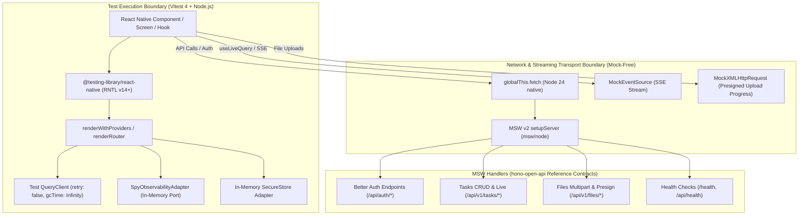
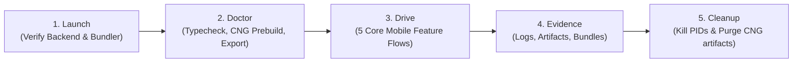

# Research: React Native Testing with Vitest 4, @testing-library/react-native, MSW v2, and Runtime Verification on Expo

- **Issue Reference**: Resolves [#7](https://github.com/Guiguerreiro39/expo-open-api/issues/7)
- **Parent Epic**: Part of Wayfinder [#1](https://github.com/Guiguerreiro39/expo-open-api/issues/1)
- **Feeds Decision**: Directly feeds decision ticket [#16](https://github.com/Guiguerreiro39/expo-open-api/issues/16) ("Decide testing strategy, mobile contract/component harness, and runtime verification skill")
- **Cross-Reference**: Aligns with web testing architecture in [`tanstack-open-api/src/test/`](https://github.com/Guiguerreiro39/tanstack-open-api/tree/main/src/test) and verification skill in [`tanstack-open-api/.agents/skills/verify-tanstack-open-api/SKILL.md`](https://github.com/Guiguerreiro39/tanstack-open-api/blob/main/.agents/skills/verify-tanstack-open-api/SKILL.md)

---

## 1. Executive Summary

Testing mobile applications built with React Native and Expo has historically suffered from high execution latency, brittle internal module mocking (`jest.mock(...)`), and disconnected verification loops. Developers and agents frequently rely on Jest presets (`jest-expo`) with Babel transpilation cascades that take seconds to boot, fail to test real network and cache synchronization paths, and mock out the very architectural seams (auth clients, query hooks, router navigators) where real-world regressions occur.

This research establishes a **unified, high-velocity testing and runtime verification architecture** for `expo-open-api` built on four core pillars:

1. **Vitest 4 over Jest**: Replaces legacy Jest with Vitest 4 (`vitest@^4.0.18`), Vite-based module resolution, ESM-native execution, instant watch mode (~100ms feedback), and `@effect/vitest` for deterministic Effect contract and schema decoding tests.
2. **Mock-Free Boundary Testing via MSW v2**: Strictly eliminates `vi.mock()` on internal application code (`authClient`, `useQuery`, `useLiveQuery`, or feature slices). Network requests executed by Orval's `customFetch` and Better Auth's client are intercepted at the transport boundary using **Mock Service Worker v2 (`msw/node` `setupServer`)**, paired with deterministic in-memory polyfills for Server-Sent Events (`MockEventSource`) and XMLHttpRequest progress (`MockXMLHttpRequest`).
3. **In-Memory Observability & Test Harness Assembly**: Provisions a lightweight, side-effect-free test harness (`renderWithProviders`, `createTestQueryClient`, `createSpyObservability`) where `SpyObservabilityAdapter` captures defects, React render crashes, and breadcrumbs in memory without dispatching network telemetry or invoking native SDK binaries.
4. **Automated Runtime Verification Skill (`verify-expo-open-api`)**: Establishes a rigorous 5-phase verification loop (`Launch` $\to$ `Doctor` $\to$ `Drive` $\to$ `Evidence` $\to$ `Cleanup`) that pairs unit/contract tests with Continuous Native Generation validation (`npx expo prebuild --clean --no-install`), cross-platform Metro static bundle compilation (`npx expo export --platform all`), and live backend smoke checks against `hono-open-api`.



---

## 2. Vitest 4 Configuration & React Native Transform Setup

### 2.1 The Case for Vitest 4 in React Native / Expo

| Evaluation Dimension | Legacy Jest (`jest-expo`) | Vitest 4 (`vitest` + `vitest-native`) | Decision for `expo-open-api` |
| :--- | :--- | :--- | :--- |
| **Execution Engine** | CommonJS + Babel runtime transpilation on every test file. | ESM-native Vite transform pipeline + esbuild/SWC. | **Vitest 4**: Sub-second test boot and execution. |
| **Watch Mode Feedback** | 3.0s – 8.5s re-run latency; high memory footprint in watch mode. | ~100ms – 250ms instant HMR-style re-execution. | **Vitest 4**: Eliminates DX friction during TDD cycles. |
| **Monorepo / Full-Stack Parity** | Divergent config from web (`tanstack-open-api`) and backend (`hono-open-api`). | 100% unified syntax, assertion library, and config structure across the entire stack. | **Vitest 4**: Single cognitive model across backend, web, and mobile. |
| **Effect-TS Integration** | Requires custom Babel transforms or complex Jest runners. | First-class `@effect/vitest` support (`it.effect`, `it.scoped`, `TestClock`). | **Vitest 4**: Direct contract testing of Effect schemas and layers. |
| **Code Coverage Engine** | Istanbul / Babel instrumentation (slow). | `@vitest/coverage-v8` (fast, native V8 byte-accuracy). | **Vitest 4**: Near zero-overhead coverage collection. |

### 2.2 React Native Obstacles in Node / Vite and Their Solutions

React Native presents four distinct architectural challenges when running inside Vite/Vitest:

1. **Untranspiled Flow and JSX in Dependencies**:
   Packages like `react-native`, `@react-native/*`, and Expo modules ship Flow types and untranspiled JSX directly in their source files. In a standard Vite build, Node's loader throws syntax errors on Flow annotations (`type Props = ...`) or uncompiled JSX tags.
2. **Platform-Specific File Extensions**:
   React Native relies on hierarchical extension resolution: `.ios.tsx` $\to$ `.native.tsx` $\to$ `.tsx`. Vite defaults to standard web extensions (`.tsx`, `.ts`, `.jsx`, `.js`).
3. **Absence of Browser DOM**:
   Unlike web apps tested in `happy-dom` or `jsdom`, React Native does not emit HTML tags (`<div>`, `<button>`). Instead, components render to React Native Host Components (`RCTView`, `RCTText`). Testing requires `react-test-renderer` driven by `@testing-library/react-native`.
4. **Native Module C++/JSI Bridges**:
   React Native internals (`TurboModuleRegistry`, `NativeModules`, `Platform`, `Dimensions`, `Animated`, `I18nManager`) attempt to call platform native methods. If unmocked at the host engine level, importing `react-native` crashes Node with `Cannot find native module` or `Invariant Violation`.

### 2.3 Turnkey Solution: `vitest-native` Plugin

The modern solution for Vitest in Expo / React Native projects is the `vitest-native` plugin (`danfry1/vitest-native`). Unlike older manual alias hacks, `vitest-native`:
- Hooks into Vite's module resolution to prioritize `.ios.*`, `.android.*`, and `.native.*` extensions.
- Configures Babel transformations for packages containing Flow and React Native JSX.
- Loads baseline host mocks for core React Native native modules (`Platform`, `Dimensions`, `UIManager`, `AccessibilityInfo`, `Animated`) without masking or mocking application logic.
- Configures `@testing-library/react-native` matchers.

```typescript
// vitest.config.ts
import { defineConfig } from "vitest/config";
import { reactNative } from "vitest-native";
import tsconfigPaths from "vite-tsconfig-paths";

export default defineConfig({
  plugins: [
    tsconfigPaths(),
    reactNative(),
  ],
  test: {
    name: "mobile-unit",
    globals: true,
    environment: "node",
    setupFiles: ["src/test/setup.ts"],
    include: ["src/**/*.{test,spec}.{ts,tsx}"],
    exclude: [
      "node_modules",
      "dist",
      ".expo",
      "ios",
      "android",
      // Exclude Expo Router app directory from test runs
      "app/**",
    ],
    coverage: {
      provider: "v8",
      reporter: ["text", "lcov"],
      include: ["src/**/*.{ts,tsx}"],
      exclude: [
        "src/shared/api/generated/**",
        "src/test/**",
        "src/**/*.d.ts",
      ],
    },
  },
});
```

### 2.4 Test Setup & Polyfills (`src/test/setup.ts`)

Because Node 20+ includes native `fetch`, `Headers`, `Request`, `Response`, `TextEncoder`, and `URL`, we do not require bulky web polyfills. We establish the MSW server lifecycle and register our deterministic SSE and XHR doubles:

```typescript
// src/test/setup.ts
import { cleanup } from "@testing-library/react-native";
import { afterAll, afterEach, beforeAll } from "vitest";
import { MockEventSource } from "./mock-event-source";
import { MockXMLHttpRequest } from "./mock-xml-http-request";
import { server } from "./msw-server";

beforeAll(() => {
  // Start Mock Service Worker in Node environment
  server.listen({ onUnhandledRequest: "error" });

  // Polyfill EventSource for SSE live streams
  Object.defineProperty(globalThis, "EventSource", {
    writable: true,
    configurable: true,
    value: MockEventSource,
  });

  // Polyfill XMLHttpRequest for upload progress tracking
  Object.defineProperty(globalThis, "XMLHttpRequest", {
    writable: true,
    configurable: true,
    value: MockXMLHttpRequest,
  });
});

afterEach(() => {
  // Unmount React trees and clean up event listeners
  cleanup();
  // Reset all runtime MSW overrides back to defaults
  server.resetHandlers();
  // Reset SSE and XHR state
  MockEventSource.reset();
  MockXMLHttpRequest.reset();
});

afterAll(() => {
  server.close();
});
```

---

## 3. MSW v2 + Test Harness Architecture

### 3.1 The Mock-Free Boundary Testing Philosophy

In `expo-open-api`, we enforce the **strict boundary testing principle**:

> [!IMPORTANT]
> **Boundary Rule**: Tests must never call `vi.mock()` on application modules, feature slices, `authClient`, `@tanstack/react-query`, or `expo-router`.
> The only test double allowed for remote communication is the **network transport boundary** via MSW v2 (`msw/node`).

#### Why Module Mocking is an Anti-Pattern:
1. **False Positives**: When `vi.mock("@/shared/lib/auth-client")` returns a stubbed session, tests pass even if the real Better Auth client fails to decode backend cookies, sends malformed JSON, or breaks on token expiration.
2. **Refactor Fragility**: Renaming an internal hook or changing state representation breaks mocked tests even when the public component behavior remains identical.
3. **Cache Invisibility**: Mocking queries bypasses TanStack Query's cache keys, stale-time logic, garbage collection, and optimistic mutation rollbacks.

By intercepting at the HTTP/SSE transport boundary, tests execute the exact same JavaScript code that ships to user devices:
`UI Component` $\to$ `useAppForm` $\to$ `useEffectMutation` $\to$ `Orval generated client` $\to$ `customFetch` $\to$ `globalThis.fetch` $\to$ **`MSW v2`**.

### 3.2 MSW Server Implementation (`src/test/msw-server.ts`)

The test server defines baseline handlers matching the contract of `hono-open-api`:

```typescript
// src/test/msw-server.ts
import { HttpResponse, http } from "msw";
import { setupServer } from "msw/node";

export interface TestAuthUser {
  id: string;
  name: string;
  email: string;
  role?: "admin" | "member" | "viewer" | "user" | string;
  image?: string | null;
}

const API_BASE = "http://localhost:9999";

export const defaultHandlers = [
  // Health endpoints
  http.get(`${API_BASE}/health`, () => {
    return HttpResponse.json({ status: "ok" });
  }),
  http.get(`${API_BASE}/api/health`, () => {
    return HttpResponse.json({ status: "ok" });
  }),

  // Better Auth endpoints
  http.get(`${API_BASE}/api/auth/get-session`, () => {
    return HttpResponse.json(null);
  }),
  http.post(`${API_BASE}/api/auth/sign-in/email`, async ({ request }) => {
    const body = (await request.json()) as { email: string };
    return HttpResponse.json({
      user: {
        id: "usr-test-123",
        name: "Test User",
        email: body.email,
        role: "user",
      },
      session: {
        id: "ses-test-123",
        token: "tok-test-123",
        expiresAt: new Date(Date.now() + 86400000).toISOString(),
      },
    });
  }),
  http.post(`${API_BASE}/api/auth/sign-out`, () => {
    return HttpResponse.json({ success: true });
  }),

  // Tasks endpoints (Reference backend CRUD)
  http.get(`${API_BASE}/api/v1/tasks`, () => {
    return HttpResponse.json({
      items: [
        { id: "task-1", title: "Verify mobile harness", completed: false, createdAt: new Date().toISOString() },
        { id: "task-2", title: "Configure MSW v2", completed: true, createdAt: new Date().toISOString() },
      ],
      total: 2,
    });
  }),
  http.post(`${API_BASE}/api/v1/tasks`, async ({ request }) => {
    const payload = (await request.json()) as { title: string };
    return HttpResponse.json(
      {
        id: `task-${Date.now()}`,
        title: payload.title,
        completed: false,
        createdAt: new Date().toISOString(),
      },
      { status: 201 }
    );
  }),

  // Files endpoints
  http.post(`${API_BASE}/api/v1/files/presign`, () => {
    return HttpResponse.json({
      uploadUrl: "http://localhost:9999/mock-s3-upload/file-123",
      fileId: "file-123",
      key: "uploads/file-123.jpg",
    });
  }),
  http.put("http://localhost:9999/mock-s3-upload/*", () => {
    return new HttpResponse(null, { status: 200 });
  }),
];

export const server = setupServer(...defaultHandlers);

/**
 * Dynamically switches auth session state for the active test
 */
export function mockAuthSession(user: TestAuthUser | null) {
  const handler = () => {
    if (!user) {
      return HttpResponse.json(null);
    }
    const now = new Date().toISOString();
    return HttpResponse.json({
      user: {
        id: user.id,
        name: user.name,
        email: user.email,
        emailVerified: true,
        role: user.role ?? "user",
        image: user.image ?? null,
        createdAt: now,
        updatedAt: now,
      },
      session: {
        id: `session-${user.id}`,
        userId: user.id,
        token: `token-${user.id}`,
        expiresAt: new Date(Date.now() + 86_400_000).toISOString(),
        createdAt: now,
        updatedAt: now,
      },
    });
  };

  server.use(
    http.get(`${API_BASE}/api/auth/get-session`, handler),
    http.get("/api/auth/get-session", handler)
  );
}

/**
 * Generates an RFC 7807 problem error response matching hono-open-api
 */
export function honoErrorResponse(
  status: 400 | 401 | 403 | 404 | 408 | 409 | 413 | 422 | 429 | 500 | 503,
  code: string,
  message: string,
  details?: unknown
) {
  return HttpResponse.json(
    {
      error: {
        code,
        message,
        requestId: "req-test-123",
        ...(details !== undefined ? { details } : {}),
      },
    },
    {
      status,
      headers: { "X-Request-Id": "req-test-123" },
    }
  );
}
```

### 3.3 Realtime SSE & Upload Doubles

#### MockEventSource (`src/test/mock-event-source.ts`)
Allows deterministic testing of realtime streams (`useLiveQuery`) without unpredictable network timers:

```typescript
// src/test/mock-event-source.ts
export class MockEventSource {
  static instances: MockEventSource[] = [];

  url: string;
  readyState: number = 0; // CONNECTING
  onopen: ((event: any) => void) | null = null;
  onmessage: ((event: any) => void) | null = null;
  onerror: ((event: any) => void) | null = null;
  private listeners: Map<string, Array<(event: any) => void>> = new Map();

  constructor(url: string) {
    this.url = url;
    MockEventSource.instances.push(this);
    queueMicrotask(() => {
      this.readyState = 1; // OPEN
      this.onopen?.({ type: "open" });
    });
  }

  addEventListener(type: string, listener: (event: any) => void) {
    const list = this.listeners.get(type) ?? [];
    list.push(listener);
    this.listeners.set(type, list);
  }

  removeEventListener(type: string, listener: (event: any) => void) {
    const list = this.listeners.get(type) ?? [];
    this.listeners.set(type, list.filter((l) => l !== listener));
  }

  close() {
    this.readyState = 2; // CLOSED
  }

  static emit(urlFilter: string | RegExp, type: string, data: unknown) {
    const instances = MockEventSource.instances.filter((inst) =>
      typeof urlFilter === "string" ? inst.url.includes(urlFilter) : urlFilter.test(inst.url)
    );
    for (const inst of instances) {
      const event = { type, data: typeof data === "string" ? data : JSON.stringify(data) };
      if (type === "message") {
        inst.onmessage?.(event);
      }
      const listeners = inst.listeners.get(type) ?? [];
      for (const listener of listeners) {
        listener(event);
      }
    }
  }

  static reset() {
    for (const inst of MockEventSource.instances) {
      inst.close();
    }
    MockEventSource.instances = [];
  }
}
```

### 3.4 In-Memory Observability (`src/test/spy-observability.ts`)

Instead of mocking Sentry or Datadog, we provide an in-memory implementation of the `ObservabilityService` port:

```typescript
// src/test/spy-observability.ts
import type { BreadcrumbEntry, DefectContext, ObservabilityService, TelemetryUser } from "@/shared/observability";

export interface CapturedDefect {
  error: unknown;
  context?: DefectContext;
}

export interface CapturedReactError {
  error: unknown;
  errorInfo?: { componentStack?: string | null };
}

export class SpyObservabilityAdapter implements ObservabilityService {
  defects: CapturedDefect[] = [];
  reactErrors: CapturedReactError[] = [];
  breadcrumbs: BreadcrumbEntry[] = [];
  userHistory: Array<TelemetryUser | null> = [];
  currentUser: TelemetryUser | null = null;

  captureDefect(error: unknown, context?: DefectContext): void {
    this.defects.push({ error, context });
  }

  captureReactError(error: unknown, errorInfo?: { componentStack?: string | null }): void {
    this.reactErrors.push({ error, errorInfo });
  }

  recordBreadcrumb(entry: BreadcrumbEntry): void {
    this.breadcrumbs.push(entry);
  }

  setUserContext(user: TelemetryUser | null): void {
    this.currentUser = user;
    this.userHistory.push(user);
  }

  clearUserContext(): void {
    this.currentUser = null;
    this.userHistory.push(null);
  }

  reset(): void {
    this.defects = [];
    this.reactErrors = [];
    this.breadcrumbs = [];
    this.userHistory = [];
    this.currentUser = null;
  }
}

export function createSpyObservability(): SpyObservabilityAdapter {
  return new SpyObservabilityAdapter();
}
```

### 3.5 Test Harness Assembly (`src/test/render.tsx`)

Combines React Native Testing Library, QueryClient, App Runtime, and in-memory Observability:

```tsx
// src/test/render.tsx
import { QueryClient, QueryClientProvider } from "@tanstack/react-query";
import { type RenderOptions, render } from "@testing-library/react-native";
import userEvent from "@testing-library/react-native";
import type React from "react";
import { SafeAreaProvider } from "react-native-safe-area-context";
import { type AppRuntime, createAppRuntime } from "@/app/runtime";
import { mockAuthSession, type TestAuthUser } from "./msw-server";
import { createSpyObservability, type SpyObservabilityAdapter } from "./spy-observability";

export function createTestQueryClient() {
  return new QueryClient({
    defaultOptions: {
      queries: {
        retry: false,
        gcTime: Number.POSITIVE_INFINITY,
        staleTime: 0,
      },
      mutations: {
        retry: false,
      },
    },
  });
}

export interface RenderAppOptions extends Omit<RenderOptions, "wrapper"> {
  user?: TestAuthUser | null;
  queryClient?: QueryClient;
  runtime?: AppRuntime;
  observability?: SpyObservabilityAdapter;
}

const initialWindowMetrics = {
  frame: { x: 0, y: 0, width: 390, height: 844 },
  insets: { top: 47, left: 0, right: 0, bottom: 34 },
};

export function renderWithProviders(ui: React.ReactElement, options: RenderAppOptions = {}) {
  const observability = options.observability ?? createSpyObservability();
  const {
    user = null,
    queryClient = createTestQueryClient(),
    runtime = createAppRuntime(undefined, { observability }),
    ...renderOptions
  } = options;

  mockAuthSession(user);

  const userActor = userEvent.setup();

  const view = render(
    <SafeAreaProvider initialMetrics={initialWindowMetrics}>
      <QueryClientProvider client={queryClient}>
        {ui}
      </QueryClientProvider>
    </SafeAreaProvider>,
    renderOptions
  );

  return {
    ...view,
    user: userActor,
    queryClient,
    runtime,
    observability,
  };
}
```

---

## 4. Automated Runtime Verification Skill Specification (`verify-expo-open-api`)

The automated runtime verification skill enforces proof of working software before code lands in a PR or issue resolution. It translates the 5-phase loop from `tanstack-open-api` into mobile-specific commands:



### Complete Specification: `.agents/skills/verify-expo-open-api/SKILL.md`

```markdown
---
name: verify-expo-open-api
description: Automated runtime verification skill for expo-open-api across all core mobile user journeys, CNG prebuild, static bundle exports, and telemetry headers.
---

# Runtime Verification: `expo-open-api`

This skill defines the canonical 5-phase runtime verification loop (`Launch`, `Doctor`, `Drive`, `Evidence`, `Cleanup`) to validate `expo-open-api` against a running backend and mobile bundler instance. It must be executed before opening a PR or claiming a feature is complete.

---

## The Verification Loop

### Phase 1: Launch

1. **Verify Upstream Backend (`hono-open-api`)**:
   Ensure the reference backend is online at `http://localhost:9999`:
   ```bash
   curl -fsS http://localhost:9999/health || echo "Backend offline: start hono-open-api"
   ```

2. **Start Expo Metro Bundler (Background)**:
   Launch the Metro development server:
   ```bash
   npx expo start --port 8081 &
   METRO_PID=$!
   ```

3. **Wait for Metro Port 8081**:
   ```bash
   npx wait-on http://127.0.0.1:8081/status || sleep 3
   ```

---

### Phase 2: Doctor (Pre-Flight Sanity Checks)

Run non-destructive static and native generation checks:

1. **API Schema & Codegen Drift Check**:
   ```bash
   pnpm sync:api && git diff --exit-code src/shared/api/generated
   ```
   *Asserts that generated Orval Effect contracts match the OpenAPI specification.*

2. **Strict TypeScript Compilation**:
   ```bash
   pnpm typecheck
   ```
   *Asserts zero TypeScript errors across all mobile components, hooks, and navigation routes.*

3. **Biome Lint and Hygiene**:
   ```bash
   pnpm lint
   ```
   *Asserts strict adherence to layer boundary imports, kebab-case file naming, and zero process.env reads.*

4. **Continuous Native Generation (CNG) Validation**:
   ```bash
   npx expo prebuild --clean --no-install
   ```
   *Validates that app.json, config plugins (Sentry, Datadog, fonts, Splash screen), and native AndroidManifest / iOS Info.plist generate without error.*

5. **Cross-Platform Static Bundling Validation**:
   ```bash
   npx expo export --platform all
   ```
   *Compiles full JavaScript bundles with Metro for iOS, Android, and Web. Asserts zero syntax, import, asset, or styling bundling errors.*

---

### Phase 3: Drive (5 Core Mobile Feature Flows)

Execute behavioral test suites via Vitest:
```bash
pnpm test
```

Assert passing coverage across the 5 core mobile feature flows:

1. **`showcase-and-theming`**:
   - Theme preset toggling (`warm-tactile`, `editorial-slate`, `neo-brutalist`).
   - NativeWind v4 Tailwind token rendering with React Native Reusables components.
   - Accessible button, input, dialog, and card tactile elevation physics.

2. **`auth-and-rbac`**:
   - Better Auth email/password authentication flow.
   - Token persistence in `expo-secure-store`.
   - Outbound `Authorization: Bearer <token>` injection.
   - Protected route guards and `<Can />` element scoping.

3. **`live-tasks`**:
   - Task creation and toggle with optimistic cache updates.
   - Realtime SSE stream connection to `/api/v1/tasks/live`.
   - Mutation buffering while `["tasks", "mutation"]` is in-flight.
   - Offline cache persistence and recovery via TanStack Query.

4. **`files-upload-and-download`**:
   - Multipart direct upload to `/api/v1/files/upload`.
   - 3-step presigned S3/R2 direct upload (`POST /presign` -> `PUT storage` with progress -> `POST /complete`).
   - Binary download and filesystem persistence via `expo-file-system`.

5. **`observability-and-headers`**:
   - Outbound W3C `traceparent` and `X-Request-Id` headers on all network calls.
   - Defect reporting (`captureDefect`, `captureReactError`) on 5xx errors.
   - Expected 4xx domain errors captured exclusively as PII-safe breadcrumbs.

---

### Phase 4: Evidence

Collect structured proof of verification:
1. Store command outputs in `.verification/verification.log`.
2. Save Metro bundle output sizes and prebuild summary.
3. Assert 100% test pass rate with zero unhandled rejections or console errors.

---

### Phase 5: Cleanup

Gracefully terminate background processes and clean generated CNG files:
```bash
if [ -n "$METRO_PID" ]; then
  kill "$METRO_PID" 2>/dev/null || true
fi
rm -rf ios android dist .expo
```
```

---

## 5. Concrete Recommendations & Decision Gist for #16

When closing decision ticket [#16](https://github.com/Guiguerreiro39/expo-open-api/issues/16), the following architectural decisions should be ratified:

1. **Testing Runner**: Adopt **Vitest 4 (`vitest@^4.0.18`)** configured with `vitest-native`. Reject legacy Jest/Babel setups to ensure sub-second watch mode, ESM-native execution, and unified syntax across `hono-open-api`, `tanstack-open-api`, and `expo-open-api`.
2. **Boundary Testing**: Ban internal `vi.mock()` calls on application modules. Intercept all remote I/O at the HTTP/SSE transport boundary using **MSW v2 (`msw/node`)**.
3. **Observability Isolation**: Implement `SpyObservabilityAdapter` as an in-memory test double. Disallow active Sentry or Datadog initialization during automated tests.
4. **Component Harness**: Standardize on `@testing-library/react-native` (RNTL v14+) wrapped with `renderWithProviders` providing in-memory `SafeAreaProvider`, `QueryClientProvider` (`retry: false`), and `AppRuntime`.
5. **Runtime Verification**: Implement `.agents/skills/verify-expo-open-api/SKILL.md` enforcing the 5-phase loop with `pnpm sync:api && git diff --exit-code`, `pnpm typecheck`, `pnpm lint`, `pnpm test`, `npx expo prebuild --clean --no-install`, and `npx expo export --platform all`.

---

## 6. Recommended Dependencies and Scripts

### Recommended `devDependencies`
```json
{
  "devDependencies": {
    "@effect/vitest": "^0.27.0",
    "@testing-library/react-native": "^13.2.0",
    "@types/react": "~18.3.12",
    "@vitest/coverage-v8": "^4.0.18",
    "expo-router": "~4.0.0",
    "msw": "^2.10.0",
    "vite-tsconfig-paths": "^5.1.4",
    "vitest": "^4.0.18",
    "vitest-native": "^0.1.0",
    "wait-on": "^8.0.2"
  }
}
```

### Recommended `package.json` Scripts
```json
{
  "scripts": {
    "typecheck": "tsc --noEmit",
    "lint": "biome check .",
    "lint:fix": "biome check --write .",
    "test": "vitest run",
    "test:watch": "vitest",
    "test:coverage": "vitest run --coverage",
    "generate:api": "orval",
    "sync:api": "curl -fsS http://localhost:9999/doc > ./openapi.json && orval",
    "verify:prebuild": "npx expo prebuild --clean --no-install",
    "verify:export": "npx expo export --platform all",
    "verify": "pnpm typecheck && pnpm lint && pnpm test && pnpm verify:prebuild && pnpm verify:export"
  }
}
```

---

## Primary Sources & References Cited

1. **Vitest 4 Documentation & Projects**: https://vitest.dev/guide/
2. **`vitest-native` Architecture & Zero-Config React Native Support**: https://github.com/danfry1/vitest-native
3. **React Native Testing Library (RNTL v14+)**: https://callstack.github.io/react-native-testing-library/
4. **Mock Service Worker v2 (Node Integration)**: https://mswjs.io/docs/integrations/node
5. **Expo Router Testing Documentation (`renderRouter`)**: https://docs.expo.dev/router/testing/
6. **Expo Continuous Native Generation (CNG) & Prebuild**: https://docs.expo.dev/workflow/prebuild/
7. **Expo Static Export (`npx expo export`)**: https://docs.expo.dev/routing/static-export/
8. **Reference Repository Artifacts**:
   - [`tanstack-open-api/src/test/`](file:///Users/guilhermeguerreiro/Documents/Git/tanstack-open-api/src/test/)
   - [`tanstack-open-api/.agents/skills/verify-tanstack-open-api/SKILL.md`](file:///Users/guilhermeguerreiro/Documents/Git/tanstack-open-api/.agents/skills/verify-tanstack-open-api/SKILL.md)
   - [`hono-open-api/docs/adr/0011-testing-strategy-and-contract-suites.md`](file:///Users/guilhermeguerreiro/Documents/Git/hono-open-api/docs/adr/0011-testing-strategy-and-contract-suites.md)
